# Learn PostgreSQL 🐘

<div align="center">

[](https://opensource.org/licenses/MIT)
[](https://www.postgresql.org/)
[](https://github.com/TheLearningHubOrg/learn-postgresql/actions/workflows/ci.yml)
[](https://github.com/TheLearningHubOrg/learn-postgresql/releases)
[](https://www.postgresql.org/docs/current/sql.html)
[](https://hub.docker.com/_/postgres)

**From your first `psql` session to staff-level PostgreSQL design, tuning and operations.**  
Process architecture and WAL, the type system and constraints, joins, CTEs and window functions, B-tree/GIN/GiST/BRIN indexes, MVCC and isolation, VACUUM, partitioning, replication, pooling and the planner.

[Getting Started](#1-stage-1-architecture-installation--first-queries) • [Schema Design](#2-stage-2-data-types-schema-design--constraints) • [Querying](#3-stage-3-querying-joins-aggregation-ctes--window-functions) • [Indexing](#4-stage-4-indexing-strategies--engine-internals) • [Transactions](#5-stage-5-concurrency-mvcc--transaction-isolation) • [Operations](#6-stage-6-partitioning-replication-pooling--tuning) • [Interview Prep](#7-stage-7-staff-postgresql-dba-interview-handbook--cheatsheet)

<br/>

<a href="https://www.buymeacoffee.com/manthanank">
  
</a>

</div>

---

**Language used in this guide.** Every example, the starter project and its tests are plain SQL run through `psql`, PostgreSQL's own client. SQL is the language the server speaks; anything a driver or ORM does ends up as these statements. The one non-SQL file is [`scripts/run-tests.sh`](scripts/run-tests.sh), a short Bash runner that creates a scratch database and feeds the files to `psql`. Server configuration is shown as `postgresql.conf` / `pg_hba.conf` snippets, and shell commands are Bash.

**Starter project.** [`sql/`](sql) builds a small shop schema (roles, types, constraints, seed data, reporting views) and [`tests/`](tests) holds self-asserting SQL tests. Stages 1-3 walk through it file by file.

```bash
# Option A: run the tests against a server you already have
PGHOST=localhost PGUSER=postgres PGPASSWORD=postgres bash scripts/run-tests.sh

# Option B: no local PostgreSQL needed; the image build runs the same tests
docker build -t learn-postgresql .
docker run -d --name shop -e POSTGRES_PASSWORD=secret -p 5432:5432 learn-postgresql
docker exec -it shop psql -U postgres -c 'SELECT * FROM shop.category_revenue'
```

---

## 🗺️ 7-Stage Pedagogical Roadmap

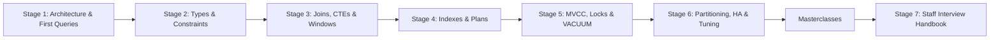

| Stage | Focus Domain | Core Concepts & Engineering Outcomes |
| :--- | :--- | :--- |
| **Stage 1** | **Architecture, Installation & First Queries** | postmaster and backend processes, shared buffers, WAL, `io_method`; cluster/database/schema and `search_path`; `$PGDATA` layout and `pg_relation_filepath()`; `psql` meta-commands (`\d`, `\gx`, `\watch`, `\copy`); roles, `GRANT`, `ALTER DEFAULT PRIVILEGES`, `pg_hba.conf` and SCRAM; `INSERT ... RETURNING`. Outcome: run PostgreSQL 18 in Docker and load the starter schema. |
| **Stage 2** | **Data Types, Schema Design & Constraints** | `numeric` vs `float8`, `timestamptz` semantics, identity columns vs `serial`, `uuidv7()`; `jsonb` operators and jsonpath; arrays, ENUMs, domains, range types; `CHECK`, `UNIQUE NULLS NOT DISTINCT`, foreign-key actions, `EXCLUDE USING gist`; stored vs virtual generated columns; `NOT VALID` + `VALIDATE`. Outcome: design a schema that rejects bad data with precise SQLSTATEs. |
| **Stage 3** | **Querying: Joins, Aggregation, CTEs & Window Functions** | logical evaluation order; inner/outer/semi/anti joins and the `NOT IN` NULL trap; `FILTER`, `GROUPING SETS`, `ROLLUP`, `CUBE`; `MATERIALIZED` CTEs and data-modifying CTEs; `WITH RECURSIVE` with `SEARCH`/`CYCLE`; `ROWS`/`RANGE`/`GROUPS` frames; `LATERAL` top-N; `ON CONFLICT` and `MERGE ... RETURNING`. Outcome: write reports as single set-based statements. |
| **Stage 4** | **Indexing Strategies & Engine Internals** | B-tree, Hash, GiST, SP-GiST, GIN, BRIN; partial, expression and covering (`INCLUDE`) indexes; `CREATE INDEX CONCURRENTLY`, `REINDEX CONCURRENTLY`; reading `EXPLAIN (ANALYZE, BUFFERS)`. |
| **Stage 5** | **Concurrency, MVCC & Transaction Isolation** | `xmin`/`xmax`/`ctid`, snapshots, Read Committed / Repeatable Read / Serializable (SSI), `FOR UPDATE SKIP LOCKED`, table lock modes, deadlocks, VACUUM, freezing and autovacuum tuning. |
| **Stage 6** | **Partitioning, Replication, Pooling & Tuning** | declarative range/list/hash partitioning and pruning, physical vs logical replication, PgBouncer pool modes, Patroni and pgBackRest, memory and checkpoint settings. |
| **Masterclasses** | **Deep dives** | Internals and end-to-end builds that combine several stages. |
| **Stage 7** | **Staff Interview Handbook** | Staff-level interview Q&As, scenario questions and a dense cheatsheet. |

---

## 🆕 PostgreSQL Versions, What's New & Migration

PostgreSQL ships one major version a year, usually in September or October, and supports each major for five years with quarterly minor releases. Minor releases (18.0 → 18.6) only fix bugs and security issues and never change the on-disk format, so you apply them by replacing binaries and restarting. Major upgrades change the catalog and sometimes the data format, so they need `pg_upgrade`, a dump and restore, or logical replication. This guide targets **PostgreSQL 18**, the current stable major. PostgreSQL 19 was in its release-candidate phase in October 2026; check the official release notes before you plan around any 19 feature.

### V.1 Release Timeline

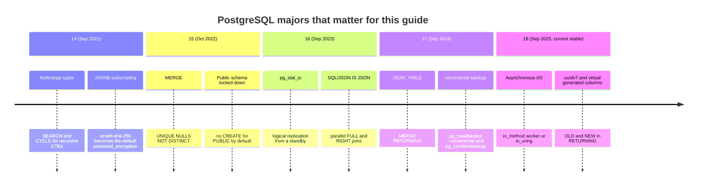

### V.2 Compatibility Matrix

| PostgreSQL | Released | Community support ends | Headline for this guide | Notes |
| --- | --- | --- | --- | --- |
| 18 | September 2025 | November 2030 | async I/O, `uuidv7()`, virtual generated columns, temporal constraints, B-tree skip scan | Target of this guide and of the starter's `postgres:18-alpine` image. `initdb` enables data checksums by default. |
| 17 | September 2024 | November 2029 | `JSON_TABLE`, `MERGE ... RETURNING`, incremental backup, `transaction_timeout` | Everything in Stages 1-3 runs on 17 except `uuidv7()` and virtual generated columns. |
| 16 | September 2023 | November 2028 | `pg_stat_io`, logical decoding on standbys, `ANY_VALUE()` | Still common on managed services. |
| 15 | October 2022 | November 2027 | `MERGE`, `UNIQUE NULLS NOT DISTINCT`, `CREATE` revoked on `public` | Oldest version that runs the starter's `UNIQUE NULLS NOT DISTINCT`. |
| 14 | September 2021 | November 2026 | multiranges, `SEARCH`/`CYCLE`, `BEGIN ATOMIC` SQL functions | Reaches end of life this month; plan the upgrade now. |
| 13 and older | 2020 and earlier | Ended | | No security fixes. Upgrade. |

Client tools are backward compatible: a newer `psql`, `pg_dump` or libpq talks to older servers, so install the client that matches your newest server. `pg_dump` from version N can dump any older server, and you should always dump with the target version's `pg_dump` when you move data forward.

### V.3 What's New in PostgreSQL 18

#### Asynchronous I/O

Before 18 every backend read data pages with synchronous system calls, one page at a time unless the kernel's readahead helped. PostgreSQL 18 adds an asynchronous I/O subsystem controlled by `io_method`. Sequential scans, bitmap heap scans and VACUUM can now issue reads ahead of time and overlap them with CPU work.

```ini
# postgresql.conf, PostgreSQL 17: no such setting; reads are synchronous

# postgresql.conf, PostgreSQL 18
io_method = worker        # default: a pool of "io worker" processes performs reads
io_workers = 3            # size of that pool
# io_method = io_uring    # Linux builds compiled with liburing; lowest overhead
# io_method = sync        # pre-18 behaviour, useful for A/B comparisons
```

You can see the workers in `pg_stat_activity` (`backend_type = 'io worker'`). The starter container shows three of them.

#### `uuidv7()`

Version 4 UUIDs are random, so each insert lands on a random leaf page of the primary-key B-tree. That spreads writes over the whole index, evicts cache and fragments pages. Version 7 UUIDs start with a 48-bit millisecond timestamp, so new keys are roughly increasing and inserts append to the right edge of the index, like a `bigint` identity.

```sql
-- Before (13-17): random v4 identifiers
CREATE TABLE events_v4 (id uuid PRIMARY KEY DEFAULT gen_random_uuid());

-- After (18): time-ordered v7 identifiers, same uuid type and size
CREATE TABLE events_v7 (id uuid PRIMARY KEY DEFAULT uuidv7());

SELECT uuidv7(), uuid_extract_version(uuidv7()), uuid_extract_timestamp(uuidv7());
```

The starter's `shop.customers.public_id` uses `uuidv7()`. Keep in mind that a v7 key leaks its creation time to anyone who sees it.

#### Virtual generated columns

Generated columns arrived in 12 as `STORED` only: the value is computed on write and takes disk space. PostgreSQL 18 adds `VIRTUAL` columns that are computed on read, and makes `VIRTUAL` the default when you omit the keyword.

```sql
-- Before (12-17): must be STORED
CREATE TABLE items_old (
  qty int, price numeric,
  total numeric GENERATED ALWAYS AS (qty * price) STORED
);

-- After (18): computed when read, no storage, no rewrite when added
CREATE TABLE items_new (
  qty int, price numeric,
  total numeric GENERATED ALWAYS AS (qty * price) VIRTUAL
);
```

Virtual columns cannot be indexed and cannot reference user-defined functions or types. The starter keeps `order_items.line_total` `STORED` because reports aggregate it constantly. [Section 2.7](#27-generated-columns-stored-vs-virtual) compares both.

#### `OLD` and `NEW` in `RETURNING`

```sql
-- Before (17): capture the old value with a self-join in a CTE
WITH before AS (SELECT product_id, price FROM shop.products WHERE sku = 'BK-PG-001')
UPDATE shop.products p SET price = p.price * 1.10
FROM before b WHERE p.product_id = b.product_id
RETURNING b.price AS old_price, p.price AS new_price;

-- After (18): RETURNING can name both row versions
UPDATE shop.products SET price = price * 1.10
WHERE sku = 'BK-PG-001'
RETURNING old.price AS old_price, new.price AS new_price;
```

This also works for `INSERT ... ON CONFLICT DO UPDATE` (where `old` is NULL for a fresh insert), `DELETE` and `MERGE`.

#### Temporal primary keys and foreign keys

Before 18 you prevented overlapping periods with an exclusion constraint, which is what the starter's `shop.promotions` does. PostgreSQL 18 lets `PRIMARY KEY` and `UNIQUE` declare the same rule with `WITHOUT OVERLAPS`, and lets a foreign key reference a period with `PERIOD`. Both still need `btree_gist` for the scalar columns.

```sql
-- Before: an exclusion constraint
CREATE TABLE room_rates_old (
  room_id int, valid tstzrange, rate numeric,
  EXCLUDE USING gist (room_id WITH =, valid WITH &&)
);

-- After (18): a temporal primary key, which a temporal foreign key can reference
CREATE TABLE room_rates (
  room_id int, valid tstzrange, rate numeric,
  PRIMARY KEY (room_id, valid WITHOUT OVERLAPS)
);
CREATE TABLE bookings (
  booking_id int GENERATED ALWAYS AS IDENTITY,
  room_id int, stay tstzrange,
  FOREIGN KEY (room_id, PERIOD stay) REFERENCES room_rates (room_id, PERIOD valid)
);
```

#### B-tree skip scan

A multicolumn B-tree on `(region, created_at)` used to be close to useless for `WHERE created_at > ...` alone, because the leading column was not constrained. In 18 the planner can "skip" through each distinct `region` value and probe the index once per value. It pays off when the leading column has few distinct values, and it can remove the need for a second index.

```sql
CREATE INDEX orders_region_created_idx ON orders (region, created_at);
-- 17: usually a sequential scan, or you add an index on (created_at)
-- 18: Index Scan using orders_region_created_idx, with a skip over region
EXPLAIN SELECT * FROM orders WHERE created_at >= now() - interval '1 day';
```

#### Smaller operational changes you will notice

| Change in 18 | Effect |
| --- | --- |
| `EXPLAIN ANALYZE` includes buffer counts by default | You no longer need to type `BUFFERS`; row counts are printed with two decimals (`rows=1.00`). |
| `initdb` enables data checksums by default | Use `--no-data-checksums` to opt out. Matters for `pg_upgrade` (see V.4). |
| `pg_upgrade` carries planner statistics over | The new cluster no longer starts with empty statistics; `vacuumdb --analyze-in-stages --missing-stats-only` fills only the gaps. |
| `pg_upgrade --swap` | Moves data directories into place instead of copying or linking; the fastest mode. |
| MD5 password authentication is deprecated | `CREATE ROLE ... PASSWORD` with MD5 hashing emits a warning. Move to `scram-sha-256`. |
| OAuth authentication method | `pg_hba.conf` can use `oauth` with a validator module, for single sign-on setups. |

### V.4 Migration Guide (17 → 18)

There are three ways to move a cluster to a new major version. Pick by how much downtime you can afford.

| Method | Downtime | Disk needed | When to use |
| --- | --- | --- | --- |
| `pg_dump` / `pg_restore` | Proportional to data size (hours for large databases) | A dump file plus the new cluster | Small databases, or when you also change hosts, encodings or collations. |
| `pg_upgrade` | Minutes with `--link` or `--swap`, regardless of size | Almost none with `--link`/`--swap` | The default for self-managed servers. |
| Logical replication | Seconds (the switchover) | A second server | Large, busy databases where minutes of downtime are too many. |

```bash
# pg_upgrade on Debian/Ubuntu with PGDG packages. Run as the postgres OS user.
sudo apt-get install -y postgresql-18

# 1. Create the new cluster. 18 turns data checksums on by default, and
#    pg_upgrade requires both clusters to match. If the old one has none:
/usr/lib/postgresql/18/bin/initdb -D /var/lib/postgresql/18/main --no-data-checksums
#    (or enable checksums on the stopped old cluster first: pg_checksums --enable -D <old datadir>)

# 2. Dry run: checks extensions, reg* columns, encodings, and so on. Changes nothing.
/usr/lib/postgresql/18/bin/pg_upgrade \
  --old-bindir=/usr/lib/postgresql/17/bin --new-bindir=/usr/lib/postgresql/18/bin \
  --old-datadir=/var/lib/postgresql/17/main --new-datadir=/var/lib/postgresql/18/main \
  --old-options='-c config_file=/etc/postgresql/17/main/postgresql.conf' \
  --new-options='-c config_file=/etc/postgresql/18/main/postgresql.conf' \
  --check

# 3. Stop the old server, then run the same command without --check, adding --swap
#    (or --link). After --swap or --link the old cluster cannot be started again,
#    so take a backup first.

# 4. Start 18, then fill any statistics pg_upgrade could not carry over.
vacuumdb --all --analyze-in-stages --missing-stats-only

# 5. Update extensions that ship new versions, in every database.
psql -d appdb -c 'ALTER EXTENSION btree_gist UPDATE'
```

With Docker the data directory layout changed in the 18 images: `PGDATA` is now `/var/lib/postgresql/18/docker` and the volume is declared at `/var/lib/postgresql`. Mount your volume at `/var/lib/postgresql`, not at `/var/lib/postgresql/data` as older tutorials show.

### V.5 Deprecations & Breaking Changes

| Version | Deprecated / removed | Replacement | What breaks and how to fix it |
| --- | --- | --- | --- |
| 18 | MD5 password authentication (deprecated) | `scram-sha-256` | Warnings now, removal later. Re-set passwords with `password_encryption = scram-sha-256` and change `md5` lines in `pg_hba.conf`. |
| 18 | Generated columns default to `VIRTUAL` | Write `STORED` explicitly when you need it | DDL copied from older versions without a keyword now creates virtual columns, which cannot be indexed. |
| 17 | `old_snapshot_threshold`, `db_user_namespace`, `adminpack` removed | None (feature dropped) | Server fails to start if the setting is still in `postgresql.conf`; delete the line. |
| 17 | Checkpoint counters moved out of `pg_stat_bgwriter` | `pg_stat_checkpointer` | Monitoring queries that read `checkpoints_timed` from `pg_stat_bgwriter` fail. |
| 16 | `promote_trigger_file`, `vacuum_defer_cleanup_age` removed | `pg_ctl promote` / `pg_promote()`; replication slots or `hot_standby_feedback` | Unknown setting at startup. |
| 15 | Statistics collector process removed | Statistics kept in shared memory | `stats_temp_directory` no longer exists; no change needed in queries. |
| 15 | `CREATE` on schema `public` revoked from `PUBLIC` | Grant `CREATE` explicitly or use your own schema | Apps that created tables in `public` as a non-owner get `permission denied for schema public`. |
| 15 | Exclusive backup mode, `pg_start_backup()` / `pg_stop_backup()` | `pg_backup_start()` / `pg_backup_stop()` (non-exclusive) | Old backup scripts fail with "function does not exist". |
| 12 | `recovery.conf` | `recovery.signal` / `standby.signal` plus settings in `postgresql.conf` | Server refuses to start if `recovery.conf` exists. |
| 10 | `serial` is still supported but legacy | `GENERATED ... AS IDENTITY` | Not removed; see [section 2.3](#23-identifiers-identity-columns-sequences--uuids). |

---

## 📋 Table of Contents

- [🆕 PostgreSQL Versions, What's New & Migration](#-postgresql-versions-whats-new--migration)
- [1. Stage 1: Architecture, Installation & First Queries](#1-stage-1-architecture-installation--first-queries)
  - [1.1 What PostgreSQL Is and When to Choose It](#11-what-postgresql-is-and-when-to-choose-it)
  - [1.2 Installing PostgreSQL 18 and Running the Starter](#12-installing-postgresql-18-and-running-the-starter)
  - [1.3 Process Architecture: Postmaster, Backends, Shared Buffers & WAL](#13-process-architecture-postmaster-backends-shared-buffers--wal)
  - [1.4 The Life of a Query](#14-the-life-of-a-query)
  - [1.5 Logical Structure: Cluster, Database, Schema & search_path](#15-logical-structure-cluster-database-schema--search_path)
  - [1.6 Physical Layout on Disk ($PGDATA)](#16-physical-layout-on-disk-pgdata)
  - [1.7 psql Power-User Guide](#17-psql-power-user-guide)
  - [1.8 Roles, Privileges & Client Authentication](#18-roles-privileges--client-authentication)
  - [1.9 First Queries: CRUD with RETURNING](#19-first-queries-crud-with-returning)
  - [1.10 Pitfalls](#110-pitfalls)
  - [1.11 Best Practices](#111-best-practices)
  - [1.12 Hands-on Exercise](#112-hands-on-exercise)
- [2. Stage 2: Data Types, Schema Design & Constraints](#2-stage-2-data-types-schema-design--constraints)
  - [2.1 The Type System at a Glance](#21-the-type-system-at-a-glance)
  - [2.2 Numbers, Text and Time](#22-numbers-text-and-time)
  - [2.3 Identifiers: Identity Columns, Sequences & UUIDs](#23-identifiers-identity-columns-sequences--uuids)
  - [2.4 JSONB vs JSON: Storage, Operators & jsonpath](#24-jsonb-vs-json-storage-operators--jsonpath)
  - [2.5 Arrays, ENUMs, Domains & Range Types](#25-arrays-enums-domains--range-types)
  - [2.6 Constraints: NOT NULL, CHECK, UNIQUE, FOREIGN KEY & EXCLUDE](#26-constraints-not-null-check-unique-foreign-key--exclude)
  - [2.7 Generated Columns: Stored vs Virtual](#27-generated-columns-stored-vs-virtual)
  - [2.8 Designing the Starter Schema](#28-designing-the-starter-schema)
  - [2.9 Changing a Live Schema Safely](#29-changing-a-live-schema-safely)
  - [2.10 Pitfalls](#210-pitfalls)
  - [2.11 Best Practices](#211-best-practices)
  - [2.12 Hands-on Exercise](#212-hands-on-exercise)
- [3. Stage 3: Querying: Joins, Aggregation, CTEs & Window Functions](#3-stage-3-querying-joins-aggregation-ctes--window-functions)
  - [3.1 Logical Query Processing Order](#31-logical-query-processing-order)
  - [3.2 Joins: Inner, Outer, Semi and Anti](#32-joins-inner-outer-semi-and-anti)
  - [3.3 Aggregation: GROUP BY, FILTER, HAVING, GROUPING SETS, ROLLUP & CUBE](#33-aggregation-group-by-filter-having-grouping-sets-rollup--cube)
  - [3.4 Subqueries and Common Table Expressions](#34-subqueries-and-common-table-expressions)
  - [3.5 Recursive CTEs: Trees and Graphs](#35-recursive-ctes-trees-and-graphs)
  - [3.6 Window Functions: Ranking, Offsets & Frames](#36-window-functions-ranking-offsets--frames)
  - [3.7 LATERAL Joins and Top-N per Group](#37-lateral-joins-and-top-n-per-group)
  - [3.8 Upserts, MERGE and Data-Modifying CTEs](#38-upserts-merge-and-data-modifying-ctes)
  - [3.9 Set Operations, DISTINCT ON and Pagination](#39-set-operations-distinct-on-and-pagination)
  - [3.10 Pitfalls](#310-pitfalls)
  - [3.11 Best Practices](#311-best-practices)
  - [3.12 Hands-on Exercise](#312-hands-on-exercise)
- [4. Stage 4: Indexing Strategies & Engine Internals](#4-stage-4-indexing-strategies--engine-internals)
  - [4.1 Index Type Taxonomy: B-Tree, Hash, GiST, SP-GiST, GIN, BRIN](#41-index-type-taxonomy-b-tree-hash-gist-sp-gist-gin-brin)
  - [4.2 GIN (Generalized Inverted Index) for JSONB & Full-Text Search](#42-gin-generalized-inverted-index-for-jsonb--full-text-search)
  - [4.3 BRIN (Block Range Index) for Massive Append-Only Data](#43-brin-block-range-index-for-massive-append-only-data)
  - [4.4 Partial, Expression & Covering Indexes (INCLUDE)](#44-partial-expression--covering-indexes-include)
  - [4.5 Index Bloat & Safe Maintenance: REINDEX CONCURRENTLY](#45-index-bloat--safe-maintenance-reindex-concurrently)
  - [4.6 Reading EXPLAIN (ANALYZE, BUFFERS)](#46-reading-explain-analyze-buffers)
- [5. Stage 5: Concurrency, MVCC & Transaction Isolation](#5-stage-5-concurrency-mvcc--transaction-isolation)
  - [5.1 MVCC Internals: Heap Tuples, xmin, xmax and ctid](#51-mvcc-internals-heap-tuples-xmin-xmax-and-ctid)
  - [5.2 The Transaction Isolation Levels & Anomaly Matrix](#52-the-transaction-isolation-levels--anomaly-matrix)
  - [5.3 Row-Level Locking Patterns: FOR UPDATE SKIP LOCKED](#53-row-level-locking-patterns-for-update-skip-locked)
  - [5.4 VACUUM, Freeze Maps & Autovacuum Tuning](#54-vacuum-freeze-maps--autovacuum-tuning)
  - [5.5 Explicit Table Lock Modes & Deadlock Prevention](#55-explicit-table-lock-modes--deadlock-prevention)
- [6. Stage 6: Partitioning, Replication, Pooling & Tuning](#6-stage-6-partitioning-replication-pooling--tuning)
  - [6.1 Declarative Partitioning: Range, List and Hash](#61-declarative-partitioning-range-list-and-hash)
  - [6.2 Physical Streaming Replication vs Logical Replication](#62-physical-streaming-replication-vs-logical-replication)
  - [6.3 Connection Pooling with PgBouncer](#63-connection-pooling-with-pgbouncer)
  - [6.4 High Availability & Disaster Recovery](#64-high-availability--disaster-recovery)
  - [6.5 Memory and Checkpoint Tuning](#65-memory-and-checkpoint-tuning)
- [7. Stage 7: Staff PostgreSQL DBA Interview Handbook & Cheatsheet](#7-stage-7-staff-postgresql-dba-interview-handbook--cheatsheet)
  - [7.1 Core Concepts (Q1-Q10)](#71-core-concepts-q1-q10)
  - [7.2 Internals & Performance (Q11-Q20)](#72-internals--performance-q11-q20)
  - [7.3 Architecture & Design (Q21-Q25)](#73-architecture--design-q21-q25)
  - [7.5 Staff Cheatsheet](#75-staff-cheatsheet)
- [🧪 Example Projects](#-example-projects)
- [📝 Cheat Sheets](#-cheat-sheets)
- [📚 Resources](#-resources)
- [🤝 Contributing](#-contributing)
- [📄 License](#-license)
- [🙏 Acknowledgments](#-acknowledgments)
- [🌐 Connect with me](#-connect-with-me)
- [☕ Support](#-support)

---

## 1. Stage 1: Architecture, Installation & First Queries

This stage explains what runs when you start PostgreSQL, where your data lives on disk, and how a client gets from a TCP connection to a result set. You need only a terminal and Docker (or a package manager). By the end you can start PostgreSQL 18, load the starter schema, navigate it with `psql`, set up roles with least privilege, and write your first `INSERT ... RETURNING`.


### 1.1 What PostgreSQL Is and When to Choose It

PostgreSQL is an open-source relational database server. It stores data in tables, enforces the integrity rules you declare, and runs every statement inside an ACID transaction. Three traits set it apart from most alternatives:

- **Extensibility.** Types, operators, index methods, procedural languages and foreign data sources are all plug-in points. PostGIS, pgvector, TimescaleDB and Citus are extensions, not forks.
- **Correctness first.** Transactional DDL (you can roll back a `CREATE TABLE`), strict type checking, real `CHECK`/`EXCLUDE` constraints and a serializable isolation level that actually serializes.
- **A large SQL surface.** Window functions, recursive CTEs, `LATERAL`, `MERGE`, JSONB with indexes, range types, full-text search and SQL/JSON are built in.

| Need | PostgreSQL | MySQL (InnoDB) | SQLite | MongoDB |
| --- | --- | --- | --- | --- |
| Deployment model | Client-server, one process per connection | Client-server, one thread per connection | Library inside your process | Client-server, document store |
| Transactional DDL | Yes | No (DDL commits implicitly) | Yes | Not applicable |
| Semi-structured data | `jsonb` with GIN indexes and jsonpath | `JSON` with generated-column indexes | JSON functions, no native index type | Native |
| Constraints | `CHECK`, `EXCLUDE`, deferrable FKs, domains | `CHECK` (8.0.16+), FKs | `CHECK`, FKs (must be enabled per connection) | Schema validation rules |
| Strongest isolation | True serializable (SSI) | Serializable via locking | Serializable (single writer) | Snapshot within a transaction |
| Typical fit | General OLTP, analytics on the same data, geospatial, multi-tenant SaaS | Web OLTP with simple queries | Embedded, edge, tests | Document-shaped data with flexible schemas |

Choose something else when you need an embedded store (SQLite), a horizontally sharded key-value store with no joins (Cassandra, DynamoDB), or columnar analytics over billions of rows as the main workload (ClickHouse, DuckDB). PostgreSQL can handle surprising amounts of analytics, but a column store wins once scans dominate.

### 1.2 Installing PostgreSQL 18 and Running the Starter

Pick one route. Docker is the quickest and matches CI.

```bash
# Docker: server plus psql in one image. The 18 image keeps data in
# /var/lib/postgresql/18/docker, so mount the volume at /var/lib/postgresql.
docker run -d --name pg18 \
  -e POSTGRES_PASSWORD=postgres \
  -p 5432:5432 \
  -v pg18data:/var/lib/postgresql \
  postgres:18-alpine

docker exec -it pg18 psql -U postgres -c 'SELECT version()'
```

```bash
# Debian / Ubuntu: use the PGDG repository so you get 18, not the distro's older major.
sudo apt-get install -y postgresql-common
sudo /usr/share/postgresql-common/pgdg/apt.postgresql.org.sh -y
sudo apt-get install -y postgresql-18
sudo -u postgres psql -c 'SELECT version()'

# macOS with Homebrew
brew install postgresql@18
brew services start postgresql@18

# Windows: use the EDB installer from postgresql.org/download, or run Docker Desktop.
```

Now run the starter project's tests against that server. The runner creates a database named `shop_test`, applies `sql/00_*.sql` to `sql/03_*.sql` in order, runs every test file, and drops the database.

```bash
git clone https://github.com/TheLearningHubOrg/learn-postgresql.git
cd learn-postgresql
PGHOST=localhost PGUSER=postgres PGPASSWORD=postgres bash scripts/run-tests.sh
```

```text
== create database shop_test
== apply sql/00_roles_and_schema.sql
== apply sql/01_schema.sql
== apply sql/02_seed.sql
== apply sql/03_reports.sql
== tests/01_schema_test.sql
psql:tests/01_schema_test.sql:7: NOTICE:  ok   six base tables in schema shop
...
All SQL tests passed.
```

Set `KEEP_DB=1` to keep `shop_test` around and explore it with `psql -d shop_test`.

| Starter file | What it creates | Stage |
| --- | --- | --- |
| [`sql/00_roles_and_schema.sql`](sql/00_roles_and_schema.sql) | Roles `shop_owner`, `shop_app`, `shop_readonly`; extension `btree_gist`; schema `shop`; default privileges | 1 |
| [`sql/01_schema.sql`](sql/01_schema.sql) | ENUM, DOMAIN, six tables, constraints, indexes | 2 |
| [`sql/02_seed.sql`](sql/02_seed.sql) | Categories, products, customers, orders, promotions | 2 |
| [`sql/03_reports.sql`](sql/03_reports.sql) | Recursive, window, `ROLLUP` and `LATERAL` reports | 3 |
| [`tests/helpers.sql`](tests/helpers.sql) | `pg_temp.assert_eq()` and `pg_temp.expect_error()` | all |
| [`tests/*_test.sql`](tests) | Assertions over the catalog, constraints, queries and MVCC | all |

### 1.3 Process Architecture: Postmaster, Backends, Shared Buffers & WAL

PostgreSQL uses processes, not threads. One supervisor process (historically called the postmaster; it is simply the first `postgres` process) owns the listening socket and the shared memory segment. Each client connection gets its own backend process, and a set of auxiliary processes handles writing, checkpoints, WAL and maintenance.

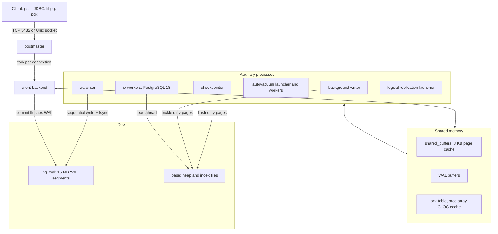

You can list these processes from SQL. This is the starter container, freshly started:

```sql
SELECT pid, backend_type FROM pg_stat_activity ORDER BY backend_type;
```

```text
 pid |         backend_type
-----+------------------------------
  74 | autovacuum launcher
  71 | background writer
  70 | checkpointer
  90 | client backend
  68 | io worker
  69 | io worker
  67 | io worker
  75 | logical replication launcher
  73 | walwriter
```

| Component | Role | What happens at runtime |
| :--- | :--- | :--- |
| postmaster | Supervisor | Accepts connections, forks backends, restarts every process if one crashes (a crashed backend could have corrupted shared memory). |
| client backend | Runs your SQL | Parses, plans and executes statements for one connection. Uses `work_mem` privately for sorts and hashes. |
| `shared_buffers` | Page cache | Every table and index page is read into an 8 KB buffer here before use. Dirty pages stay here until written. |
| WAL (write-ahead log) | Durability | Every change is first described in WAL. `COMMIT` returns only after the WAL record is flushed to disk, so a crash can be repaired by replaying WAL. Data files may lag behind. |
| walwriter | WAL flushing | Flushes WAL buffers in the background so commits rarely wait for a full flush. |
| checkpointer | Recovery baseline | Periodically writes all dirty pages and records a checkpoint. Crash recovery starts replaying WAL from the last checkpoint. |
| background writer | Smoothing | Writes some dirty buffers ahead of time so backends find clean buffers to reuse. |
| autovacuum | Garbage collection | Removes dead row versions, updates statistics and freezes old transaction IDs ([Stage 5](#5-stage-5-concurrency-mvcc--transaction-isolation)). |
| io workers (18) | Asynchronous reads | With `io_method = worker`, they perform reads ahead of the backend that needs the pages. |

Two consequences follow directly. First, each connection is a process with its own memory, so thousands of idle connections cost real RAM and scheduler time; that is why connection poolers exist ([Stage 6](#6-stage-6-partitioning-replication-pooling--tuning)). Second, durability comes from the WAL, not from the data files, which is why `pg_wal` must never be deleted by hand and why replication and point-in-time recovery are both built on shipping WAL.

### 1.4 The Life of a Query

Every statement goes through the same pipeline inside the backend. Knowing the stages tells you where an error message comes from and what `EXPLAIN` is showing you.

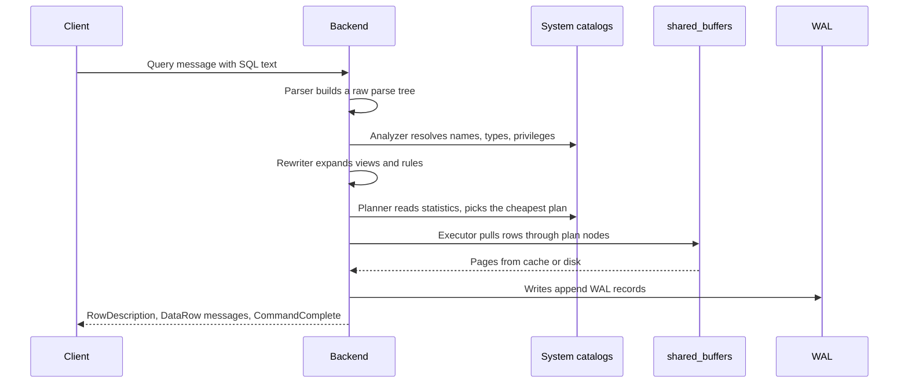

| Stage | Typical error raised here | Example |
| --- | --- | --- |
| Parser | `42601 syntax_error` | `SELEC 1` |
| Analyzer | `42P01 undefined_table`, `42703 undefined_column`, `42883 undefined_function`, `42501 insufficient_privilege` | `SELECT nme FROM shop.customers` |
| Rewriter | Recursion in rules, view errors | Rare in practice |
| Planner | Usually none; produces a plan | `EXPLAIN` shows its output |
| Executor | `23xxx` constraint violations, `22xxx` data exceptions, `40001` serialization failures | Inserting a negative price |

The `shop.order_totals` view is a good example of the rewriter at work. When you `SELECT * FROM shop.order_totals WHERE order_id = 1`, the rewriter substitutes the view's query, and the planner pushes `order_id = 1` into it, so only one order is aggregated. Views cost nothing at run time unless they block that pushdown (for example with `DISTINCT ON` or a window function over the filtered column).

### 1.5 Logical Structure: Cluster, Database, Schema & search_path

```text
Cluster (one data directory, one port: 5432)
 ├── roles and tablespaces (shared by every database)
 ├── Database: shop_test
 │    ├── Schema: pg_catalog   (system catalogs, always searched first)
 │    ├── Schema: public       (created by default, CREATE revoked from PUBLIC since 15)
 │    └── Schema: shop         (the starter project)
 │         ├── tables, views, sequences, indexes
 │         └── types, domains, functions
 └── Database: postgres        (default maintenance database)
```

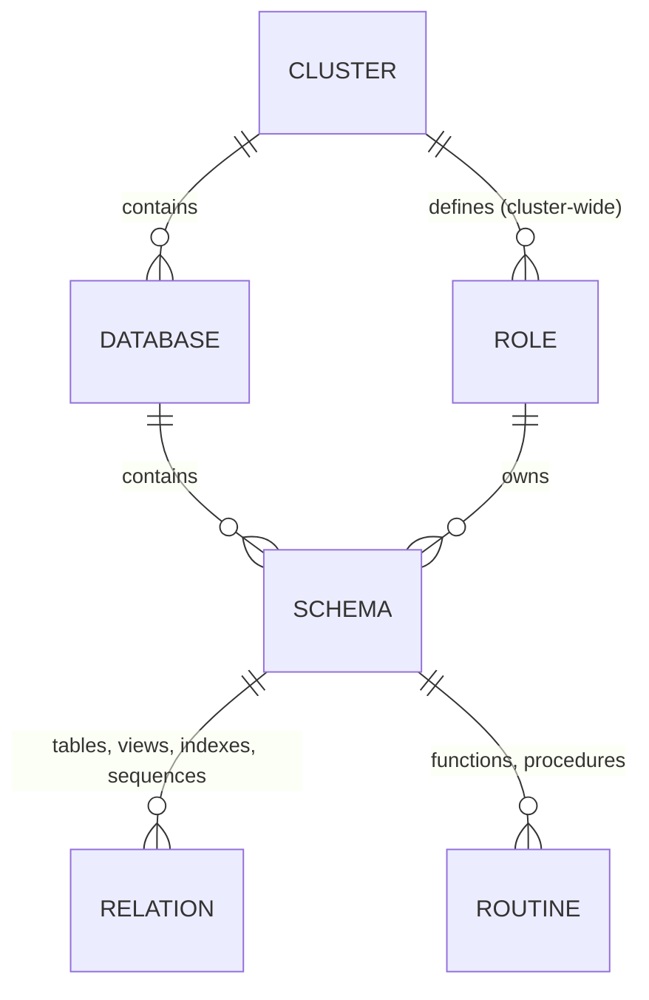

- **Cluster.** One `$PGDATA` directory served by one postmaster. "Cluster" here means a single server instance, not a group of machines.
- **Database.** A hard boundary. A connection is bound to one database, and a query cannot join tables from two databases without `postgres_fdw` or `dblink`. Use separate databases for unrelated applications.
- **Schema.** A namespace inside a database. Queries join across schemas freely, so schemas are the right tool for separating modules of one application (`billing`, `shop`, `audit`) or for privileges.
- **Roles** are cluster-wide. That is why [`sql/00_roles_and_schema.sql`](sql/00_roles_and_schema.sql) wraps `CREATE ROLE` in an `IF NOT EXISTS` check: a second database on the same server would otherwise fail on the existing roles.

Unqualified names are resolved through `search_path`, a list of schemas searched left to right:

```sql
SHOW search_path;                      -- "$user", public
SET search_path = shop, public;        -- this session only
SELECT count(*) FROM products;         -- now resolves to shop.products

ALTER ROLE shop_app SET search_path = shop, public;          -- default for every new session of that role
ALTER DATABASE shop_test SET search_path = shop, public;     -- default for the database
```

The starter writes `shop.` in front of every name instead. Fully qualified names make scripts independent of whoever runs them and close a class of attacks where a malicious user creates a function or table with the same name in a schema earlier on the path. Functions marked `SECURITY DEFINER` must always pin their path with `SET search_path = ...` in the function definition.

### 1.6 Physical Layout on Disk ($PGDATA)

The data directory holds everything: configuration, catalogs, table files and WAL.

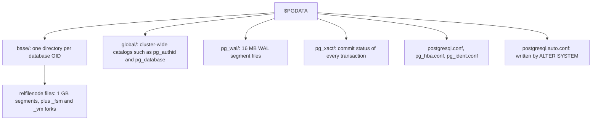

| Directory / file | Contents | Operational notes |
| :--- | :--- | :--- |
| `base/<db_oid>/<relfilenode>` | Heap and index pages (8 KB each). Files split into 1 GB segments: `17200`, `17200.1`, ... | Each relation also has a free space map (`17200_fsm`) and a visibility map (`17200_vm`). `VACUUM FULL`, `TRUNCATE` and `CLUSTER` assign a new relfilenode. |
| `global/` | Catalogs shared by every database: roles (`pg_authid`), databases, tablespaces | |
| `pg_wal/` | WAL segments named by timeline and position, such as `000000010000000000000001` | Never delete files by hand. If it fills the disk, look for an inactive replication slot or a failing `archive_command`. |
| `pg_xact/` | Two bits per transaction: in progress, committed, aborted | MVCC visibility checks consult it (through hint bits, mostly) |
| `postgresql.conf` | Server settings | Many settings reload with `SELECT pg_reload_conf()`; some (`shared_buffers`, `max_connections`) need a restart. `pg_settings.context` tells you which. |
| `pg_hba.conf` | Client authentication rules | See [section 1.8](#18-roles-privileges--client-authentication). |
| `postgresql.auto.conf` | Settings from `ALTER SYSTEM SET` | Read after `postgresql.conf`, so it wins. Do not edit by hand. |

Map a table to its file from SQL:

```sql
SHOW data_directory;                                -- /var/lib/postgresql/18/docker in the Docker image
SELECT pg_relation_filepath('shop.orders');         -- base/5/17200 (OIDs differ per install)
SELECT pg_size_pretty(pg_total_relation_size('shop.orders'));  -- heap + indexes + TOAST
SELECT name, setting, context FROM pg_settings
WHERE name IN ('shared_buffers', 'work_mem', 'io_method', 'data_checksums');
```

The page size is fixed at compile time (8 KB by default). A row cannot span pages, so large values are compressed and moved out of line by TOAST, which is covered with the interview questions in [Stage 7](#7-stage-7-staff-postgresql-dba-interview-handbook--cheatsheet).

### 1.7 psql Power-User Guide

`psql` is the reference client. It sends SQL to the server and adds backslash meta-commands that it executes itself, usually by running catalog queries for you (`\set ECHO_HIDDEN on` shows them).

```bash
# Connection options; each has a libpq environment variable equivalent
psql -h localhost -p 5432 -U postgres -d shop_test      # PGHOST PGPORT PGUSER PGDATABASE
psql "postgresql://postgres@localhost:5432/shop_test?sslmode=disable"
psql -X -v ON_ERROR_STOP=1 -f sql/01_schema.sql          # what the test runner does
```

| Meta-command | What it does | Example |
| :--- | :--- | :--- |
| `\l+` | List databases with size, encoding and collation | `\l+` |
| `\c dbname [user]` | Reconnect to another database | `\c shop_test` |
| `\dn+` | List schemas with owners and privileges | `\dn+ shop` |
| `\dt+ pattern` | List tables with size | `\dt+ shop.*` |
| `\d name` | Describe a table, view, index or sequence | `\d shop.orders` |
| `\d+ name` | Same, with storage, comments and view definition | `\d+ shop.order_totals` |
| `\di+`, `\dv`, `\df+`, `\dT+`, `\dD` | Indexes, views, functions, types, domains | `\df shop.*` |
| `\dp name` | Privileges on a table | `\dp shop.orders` |
| `\ddp` | Default privileges | `\ddp` |
| `\du` | Roles and their attributes | `\du shop*` |
| `\x auto` | Expanded output when rows are too wide | `\x auto` |
| `\gx` | Run the current query once in expanded mode | `SELECT * FROM shop.products LIMIT 1 \gx` |
| `\timing on` | Print elapsed time after each statement | |
| `\watch 2` | Re-run the last query every 2 seconds | Watching `pg_stat_activity` |
| `\e` | Edit the query buffer in `$EDITOR` | |
| `\copy` | Client-side COPY: reads or writes files on the client machine | `\copy shop.products TO 'products.csv' CSV HEADER` |
| `\set`, `:var`, `:'var'` | Variables, interpolated as SQL or as a quoted literal | `\set sku 'BK-PG-001'` then `WHERE sku = :'sku'` |
| `\gset` | Store the columns of a one-row result into variables | `SELECT max(order_id) AS last_id FROM shop.orders \gset` |
| `\bind ... \g` | Run with bind parameters (extended protocol, 16+) | `SELECT $1::int + 1 \bind 41 \g` |
| `\errverbose` | Show the last error with SQLSTATE and source location | |
| `\?`, `\h CREATE INDEX` | Help on meta-commands and SQL syntax | |

`\d shop.orders` on the starter shows how much the catalog records for you:

```text
                                     Table "shop.orders"
   Column    |           Type           | Collation | Nullable |           Default
-------------+--------------------------+-----------+----------+------------------------------
 order_id    | bigint                   |           | not null | generated always as identity
 customer_id | bigint                   |           | not null |
 status      | shop.order_status        |           | not null | 'pending'::shop.order_status
 ordered_at  | timestamp with time zone |           | not null | now()
 shipped_at  | timestamp with time zone |           |          |
Indexes:
    "orders_pkey" PRIMARY KEY, btree (order_id)
    "orders_customer_id_idx" btree (customer_id)
Check constraints:
    "orders_shipped_after_ordered" CHECK (shipped_at >= ordered_at)
    "orders_shipped_has_date" CHECK ((status = 'shipped'::shop.order_status) = (shipped_at IS NOT NULL))
Foreign-key constraints:
    "orders_customer_id_fkey" FOREIGN KEY (customer_id) REFERENCES shop.customers(customer_id) ON DELETE RESTRICT
Referenced by:
    TABLE "shop.order_items" CONSTRAINT "order_items_order_id_fkey" FOREIGN KEY (order_id) REFERENCES shop.orders(order_id) ON DELETE CASCADE
```

A `~/.psqlrc` that makes daily work safer:

```text
\set QUIET 1
\pset null '(null)'
\x auto
\timing on
\set ON_ERROR_ROLLBACK interactive
\set HISTFILE ~/.psql_history- :DBNAME
\set PROMPT1 '%n@%/%R%# '
\unset QUIET
```

`ON_ERROR_ROLLBACK interactive` wraps each statement you type in a savepoint, so a typo inside a long manual transaction does not abort the whole transaction. Scripts run with `-X`, which skips `~/.psqlrc`, so they behave the same on every machine.

### 1.8 Roles, Privileges & Client Authentication

A **role** is both a user and a group: a role with `LOGIN` can connect, and any role can be granted to another. Privileges are checked at three levels: can you connect to the database, can you use the schema, and can you act on the object.

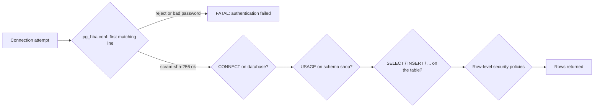

The starter separates three duties:

```sql
-- From sql/00_roles_and_schema.sql
CREATE ROLE shop_owner NOLOGIN;      -- owns every object; nobody logs in as it
CREATE ROLE shop_app NOLOGIN;        -- read/write group role for the application
CREATE ROLE shop_readonly NOLOGIN;   -- reporting and support access

CREATE SCHEMA IF NOT EXISTS shop AUTHORIZATION shop_owner;
REVOKE ALL ON SCHEMA shop FROM PUBLIC;
GRANT USAGE ON SCHEMA shop TO shop_app, shop_readonly;

ALTER DEFAULT PRIVILEGES FOR ROLE shop_owner IN SCHEMA shop
  GRANT SELECT, INSERT, UPDATE, DELETE ON TABLES TO shop_app;
ALTER DEFAULT PRIVILEGES FOR ROLE shop_owner IN SCHEMA shop
  GRANT SELECT ON TABLES TO shop_readonly;
```

| Line / API | Role | What happens at runtime |
| :--- | :--- | :--- |
| `CREATE ROLE ... NOLOGIN` | Group roles | No password, cannot connect. Real logins are granted membership: `CREATE ROLE api LOGIN PASSWORD '...' IN ROLE shop_app`. |
| `CREATE SCHEMA ... AUTHORIZATION shop_owner` | Ownership | The owner can create, alter and drop anything in the schema. Owners bypass table privileges, so the application should never connect as the owner. |
| `REVOKE ALL ON SCHEMA shop FROM PUBLIC` | Lock down | `PUBLIC` means every role, including ones created later. |
| `GRANT USAGE ON SCHEMA` | Name lookup | Without `USAGE`, even a table-level `SELECT` grant fails with `permission denied for schema shop`. |
| `ALTER DEFAULT PRIVILEGES FOR ROLE shop_owner` | Future objects | Applies only to objects that `shop_owner` creates after this statement. That is why [`sql/01_schema.sql`](sql/01_schema.sql) starts with `SET ROLE shop_owner`: tables created by `postgres` would not get these grants. |

Check the result with functions instead of guesswork. The starter's tests do exactly this:

```sql
SELECT has_table_privilege('shop_readonly', 'shop.orders', 'INSERT');   -- false
SELECT has_schema_privilege('shop_app', 'shop', 'CREATE');               -- false
```

Create a login for the application and set its password from `psql` so the password never appears in a SQL file or the server log:

```sql
CREATE ROLE shop_api LOGIN IN ROLE shop_app CONNECTION LIMIT 50;
\password shop_api
ALTER ROLE shop_api SET search_path = shop, public;
ALTER ROLE shop_api SET statement_timeout = '5s';
```

`pg_hba.conf` decides who may even try. The server reads it top to bottom and uses the **first** line that matches the connection type, database, user and address:

```text
# TYPE   DATABASE    USER          ADDRESS          METHOD
local    all         postgres                       peer            # OS user postgres via Unix socket
hostssl  shop        shop_api      10.0.0.0/8       scram-sha-256   # app servers, TLS required
hostssl  shop        +shop_readonly 10.20.0.0/16    scram-sha-256   # "+" means members of the role
host     all         all           0.0.0.0/0        reject          # everything else
```

Reload after editing (`SELECT pg_reload_conf();`) and check `SELECT * FROM pg_hba_file_rules WHERE error IS NOT NULL;` for typos before you rely on it.

The old guide's setup snippet is still a useful pattern for a dedicated application database. Two corrections apply: `CREATE DATABASE` with a locale different from `template1` needs `TEMPLATE template0`, and passwords belong in `\password`, not in the script.

```sql
CREATE ROLE app_owner NOLOGIN;
CREATE DATABASE enterprise_core
  OWNER app_owner
  TEMPLATE template0
  ENCODING 'UTF8'
  LOCALE_PROVIDER icu
  ICU_LOCALE 'und';
\c enterprise_core
CREATE SCHEMA IF NOT EXISTS ecommerce AUTHORIZATION app_owner;
REVOKE ALL ON DATABASE enterprise_core FROM PUBLIC;
```

| Statement / option | Purpose | Guarantee |
| :--- | :--- | :--- |
| `OWNER app_owner` | Ownership | A non-superuser owns the database and its default schema objects. |
| `TEMPLATE template0` | Clean copy | `template0` has no local additions, so any encoding or locale may be chosen. |
| `ENCODING 'UTF8'` | Character set | Stores any Unicode text. Encoding cannot be changed later without a dump and reload. |
| `LOCALE_PROVIDER icu` | Collation library | ICU collations are versioned and identical across operating systems, unlike glibc locales, whose sort order can change on an OS upgrade and corrupt text indexes. PostgreSQL 17+ also offers the built-in `builtin` provider with `C.UTF-8`. |
| `REVOKE ALL ON DATABASE ... FROM PUBLIC` | Lock down | Removes the default `CONNECT` and `TEMPORARY` privileges for every role. |

### 1.9 First Queries: CRUD with RETURNING

With the starter loaded (`KEEP_DB=1 bash scripts/run-tests.sh`, then `psql -d shop_test`), try the four basic statements. Each one runs in its own transaction unless you open one with `BEGIN`.

```sql
-- Create: RETURNING hands back generated values in the same round trip
INSERT INTO shop.customers (email, full_name, country)
VALUES ('alan@example.com', 'Alan Turing', 'GB')
RETURNING customer_id, public_id, created_at;

-- Read: filter, sort, limit
SELECT sku, title, price
FROM shop.products
WHERE price BETWEEN 30 AND 60
ORDER BY price DESC
LIMIT 3;

-- Update: change a row and see the result
UPDATE shop.products
SET price = price - 5
WHERE sku = 'BK-SQL-002'
RETURNING sku, price;

-- Delete: restricted by the foreign key if the customer has orders
DELETE FROM shop.customers
WHERE email = 'alan@example.com'
RETURNING customer_id;
```

| Line / API | Role | What happens at runtime |
| :--- | :--- | :--- |
| `INSERT ... VALUES` | Add rows | Identity, `uuidv7()` and `now()` defaults fill the omitted columns. Constraints are checked per row. |
| `RETURNING` | Output from DML | Avoids a second `SELECT` and the race between insert and read. In 18 you can return `old.*` and `new.*`. |
| `WHERE price BETWEEN 30 AND 60` | Filter | `BETWEEN` is inclusive on both ends. |
| `ORDER BY ... LIMIT 3` | Top N | Without `ORDER BY` the row order is not defined, even if it looks stable. |
| `UPDATE ... SET price = price - 5` | Modify | Writes a new row version; the old one becomes dead ([Stage 5](#5-stage-5-concurrency-mvcc--transaction-isolation)). `CHECK (price >= 0)` still applies. |
| `DELETE` | Remove | Fails with `23001 restrict_violation` if `shop.orders` references the customer, because the FK says `ON DELETE RESTRICT`. |

Wrap experiments in a transaction so you can undo them:

```sql
BEGIN;
DELETE FROM shop.order_items;          -- oops
SELECT count(*) FROM shop.order_items; -- 0, but only in this transaction
ROLLBACK;                              -- everything is back
```

Load files efficiently with `COPY`, which is many times faster than row-by-row `INSERT`:

```sql
-- Server-side COPY reads a file on the database server and needs pg_read_server_files.
-- psql's \copy streams a file from your machine instead:
\copy shop.customers (email, full_name, country) FROM 'customers.csv' WITH (FORMAT csv, HEADER true)

-- PostgreSQL 17+: skip malformed rows instead of failing the whole load
COPY shop.customers (email, full_name, country) FROM STDIN WITH (FORMAT csv, ON_ERROR ignore);
```

`ON_ERROR ignore` skips rows that fail type conversion (for example `abc` in an integer column). It does not skip rows that fail constraints; those still abort the `COPY`.

### 1.10 Pitfalls

| Pitfall | Symptom | Fix |
| --- | --- | --- |
| Mounting the Docker volume at `/var/lib/postgresql/data` with the 18 image | Data disappears when the container is recreated, or the entrypoint warns about the layout | Mount at `/var/lib/postgresql`; `PGDATA` is `/var/lib/postgresql/18/docker` in the 18 images. |
| Editing `pg_hba.conf` without reloading | Old rules still apply | `SELECT pg_reload_conf();` and check `pg_hba_file_rules` for errors. |
| A broad line above a specific one in `pg_hba.conf` | `FATAL: no pg_hba.conf entry for host ...` or the wrong auth method used | Order lines from most specific to least specific; the first match wins. |
| Application connects as the schema owner | Migrations and app share power; a SQL injection can `DROP TABLE` | Separate owner, read/write and read-only roles as in `sql/00_roles_and_schema.sql`. |
| Creating tables as `postgres` after setting default privileges for `shop_owner` | `ERROR: permission denied for table products` for `shop_app` | Default privileges apply only to objects created by the named role. Use `SET ROLE shop_owner` or grant explicitly. |
| Relying on `public` for application tables on 15+ | `ERROR: permission denied for schema public` | Create a schema for the app, or `GRANT CREATE ON SCHEMA public TO ...` deliberately. |
| `CREATE DATABASE ... LC_COLLATE` different from `template1` | `ERROR: new collation (...) is incompatible with the collation of the template database` | Add `TEMPLATE template0`. |
| Deleting files in `pg_wal` to free disk space | Server refuses to start: `could not locate a valid checkpoint record` | Never delete WAL by hand. Find the reason it is retained: `pg_replication_slots` with `active = false`, or a failing `archive_command`. |
| Passwords in SQL files or shell history | Secrets end up in Git, `~/.psql_history` and possibly the server log | Use `\password`, a `~/.pgpass` file (mode 0600) or a secrets manager. |
| Using `localhost` inside a container to reach the host | `connection refused` | From a container, use the service name (Compose) or `host.docker.internal`. |

### 1.11 Best Practices

- **Run the current major in development and CI**: version-specific behaviour (defaults, removed settings) shows up early instead of during an upgrade.
- **Use `psql -X -v ON_ERROR_STOP=1` for scripts**: without it, `psql` keeps going after an error and the script half-applies.
- **Give the application its own login role that is not the owner**: least privilege limits the damage of a bug or an injection.
- **Schema-qualify names in scripts and pin `search_path` in `SECURITY DEFINER` functions**: name resolution then cannot be hijacked by an earlier schema on the path.
- **Choose ICU or the builtin collation provider for new databases**: glibc collation changes across OS upgrades silently corrupt text indexes.
- **Keep `postgresql.conf` under configuration management and avoid ad-hoc `ALTER SYSTEM`**: `postgresql.auto.conf` overrides the file, and drift between servers is hard to see.
- **Check which settings need a restart before changing them**: `SELECT name, context FROM pg_settings` shows `postmaster` for restart-only settings.
- **Prefer `COPY` / `\copy` for bulk loads**: it avoids per-statement overhead and is the fastest load path.

### 1.12 Hands-on Exercise

1. Start the starter with `KEEP_DB=1 bash scripts/run-tests.sh` (or the Docker image) and connect with `psql -d shop_test`.
2. Create a login role `report_bot` that is a member of `shop_readonly`, set its password with `\password`, and connect as it.
3. As `report_bot`, run `SELECT count(*) FROM shop.orders;` and then try `DELETE FROM shop.orders;`.
4. Find the file that stores `shop.products` on disk and its total size including indexes.

Expected output: step 3 returns `6` for the count, then `ERROR:  permission denied for table orders` (SQLSTATE `42501`). Step 4 returns a path like `base/16384/17166` and a size of a few dozen kB.

Solution: the role pattern is in [`sql/00_roles_and_schema.sql`](sql/00_roles_and_schema.sql); the privilege checks are the last four assertions in [`tests/01_schema_test.sql`](tests/01_schema_test.sql). For step 4 use `pg_relation_filepath()` and `pg_total_relation_size()` from [section 1.6](#16-physical-layout-on-disk-pgdata).

[Back to top ⤴️](#-table-of-contents)

---

## 2. Stage 2: Data Types, Schema Design & Constraints

This stage is about making the database refuse bad data. You will pick column types that store exactly what you mean, generate keys correctly, model semi-structured data with `jsonb`, and declare the rules (uniqueness, references, ranges that must not overlap) as constraints the server enforces for every writer. Prerequisite: Stage 1 and the starter loaded with `KEEP_DB=1`. Afterwards you can read and extend [`sql/01_schema.sql`](sql/01_schema.sql) and predict the SQLSTATE each bad write produces.

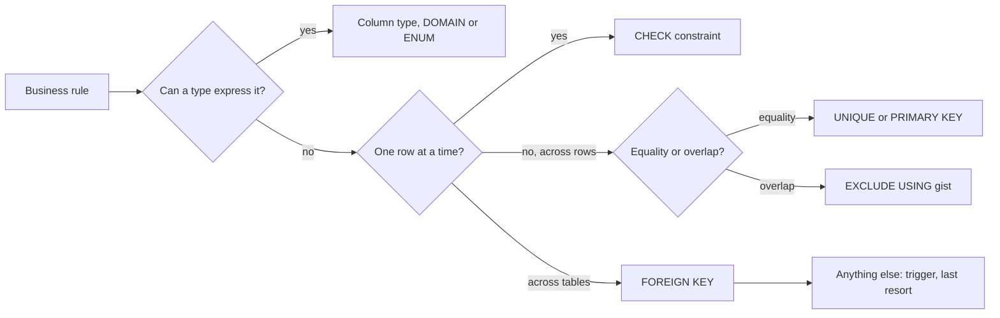

### 2.1 The Type System at a Glance

Every value in PostgreSQL has exactly one type, and the server converts between types only where a cast is defined. Picking the right type gives you validation, compact storage and the right operators for free.

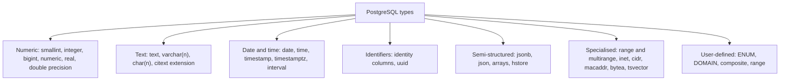

| Data | Use | Avoid | Why |
| --- | --- | --- | --- |
| Money, quantities with fixed decimals | `numeric(p, s)` | `real`, `double precision`, `money` | Floats cannot represent 0.1 exactly; `money` depends on the `lc_monetary` setting. |
| Counters, surrogate keys | `bigint` (or `integer` for small, bounded tables) | `serial` | Identity columns are standard SQL and safer ([2.3](#23-identifiers-identity-columns-sequences--uuids)). |
| Points in time | `timestamptz` | `timestamp` without time zone | `timestamptz` stores an absolute instant. |
| Strings | `text`, plus a `CHECK` if you need a limit | `char(n)` | `char(n)` pads with spaces and compares oddly; `varchar(n)` and `text` perform the same. |
| Externally visible IDs | `uuid` with `uuidv7()` | `text` holding a UUID | 16 bytes instead of 37, with validation. |
| Flags | `boolean` | `char(1)` with 'Y'/'N' | Three-valued logic (true, false, NULL) is explicit. |
| Optional attributes that vary per row | `jsonb` | One sparse column per attribute | GIN-indexable containment queries. |
| IP addresses | `inet`, `cidr` | `text` | Validation and operators such as `<<=` (is contained by). |

### 2.2 Numbers, Text and Time

**Exact versus binary numbers.** `numeric` stores decimal digits exactly, so sums of prices are correct to the cent. `double precision` is an IEEE 754 binary float: fast and compact, but most decimal fractions are approximations.

```sql
SELECT 0.1::float8 + 0.2::float8 = 0.3::float8 AS float_eq,
       0.1::numeric + 0.2 = 0.3                 AS numeric_eq;
```

```text
 float_eq | numeric_eq
----------+------------
 f        | t
```

`numeric(10,2)` means up to 10 digits in total, 2 after the decimal point; inserting `12.345` rounds to `12.35`, and inserting `123456789.00` fails with `22003 numeric_value_out_of_range`. Integer division truncates (`7 / 2` is `3`); cast one side (`7 / 2.0` or `7::numeric / 2`) when you want a fraction.

**Text.** `text` and `varchar(n)` are the same type internally; the only difference is the length check. A length rule that might change is easier to keep in a `CHECK` constraint, because changing `varchar(50)` to `varchar(100)` is cheap but shrinking it requires a rewrite and lock. Case-insensitive comparison has three common solutions, each with a trade-off:

| Approach | Example | Trade-off |
| --- | --- | --- |
| Expression index on `lower()` | `CREATE UNIQUE INDEX ON shop.customers (lower(email))` (used by the starter) | Queries must say `WHERE lower(email) = lower($1)` to use the index. |
| Nondeterministic ICU collation | `CREATE COLLATION ci (provider = icu, locale = 'und-u-ks-level2', deterministic = false)` | `LIKE` support for nondeterministic collations is limited; check your version's release notes. |
| `citext` extension | `email citext UNIQUE` | Extra extension; operators wrap `lower()` internally. |

**Time.** `timestamptz` does not store a time zone. It stores an absolute instant in UTC and converts to and from the session's `TimeZone` setting at the edges. `timestamp` (without time zone) stores a wall-clock reading with no zone, which means nothing on its own.

```sql
SET timezone = 'Asia/Kolkata';
SELECT timestamptz '2026-01-10 10:00+00';                       -- 2026-01-10 15:30:00+05:30
SELECT timestamptz '2026-03-08 12:00+00' AT TIME ZONE 'America/New_York';  -- 2026-03-08 08:00:00 (a timestamp)
SELECT date_trunc('month', now() AT TIME ZONE 'UTC')::date;     -- first day of the month in UTC
```

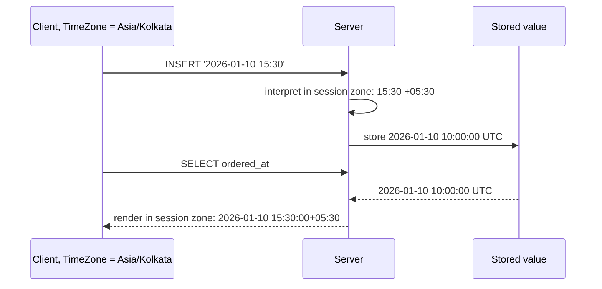

The reporting view `shop.revenue_rollup` groups orders by `date_trunc('month', ordered_at AT TIME ZONE 'UTC')`. Without the explicit zone, the month an order belongs to would depend on the `TimeZone` setting of whoever runs the report.

Use `now()` (start of the transaction, same value for every row in the statement) for business timestamps, and `clock_timestamp()` (changes during the statement) only when you need wall-clock progress, such as timing a loop. Intervals do calendar arithmetic: `date '2026-01-31' + interval '1 month'` is `2026-02-28`.

### 2.3 Identifiers: Identity Columns, Sequences & UUIDs

Every table in the starter has a surrogate key declared as `GENERATED ALWAYS AS IDENTITY`:

```sql
CREATE TABLE shop.orders (
  order_id bigint GENERATED ALWAYS AS IDENTITY PRIMARY KEY,
  ...
);
```

An identity column is backed by a sequence that belongs to the column. It differs from the older `serial` shorthand in ways that matter:

| | `serial` / `bigserial` | `GENERATED BY DEFAULT AS IDENTITY` | `GENERATED ALWAYS AS IDENTITY` |
| --- | --- | --- | --- |
| Standard SQL | No | Yes | Yes |
| Explicit value in `INSERT` | Allowed silently | Allowed | Rejected with `428C9` unless `OVERRIDING SYSTEM VALUE` |
| Sequence ownership and grants | Separate object; app role needs `USAGE` on the sequence | Part of the column; table `INSERT` privilege is enough | Same |
| `CREATE TABLE ... (LIKE t INCLUDING ALL)` | Copies the default that points at the old table's sequence | Creates a new sequence | Creates a new sequence |
| Reset after a bulk load | `setval('t_id_seq', max(id))` | `ALTER TABLE t ALTER COLUMN id RESTART WITH n` | Same |

`ALWAYS` is the safer default: a script that inserts explicit IDs fails loudly instead of creating rows the sequence will later collide with. The starter's test asserts it:

```sql
SELECT pg_temp.expect_error(
  $$INSERT INTO shop.orders (order_id, customer_id)
    SELECT 1, customer_id FROM shop.customers LIMIT 1$$,
  '428C9', 'GENERATED ALWAYS identity rejects an explicit id');
```

Sequences are not transactional. A rolled-back insert still consumes its number, and each backend may cache values (`CACHE 20`), so gaps are normal. Never use an identity value as a gapless invoice number; generate those from a counter row updated in the same transaction.

Sequence order is not insertion order across a statement, either. The starter's seed inserts orders with an `INSERT ... SELECT ... JOIN`, and the join produces rows in hash order, so Ada's January order got `order_id = 2` while her February order got `1`. Tests and reports that need chronology sort by `ordered_at`, never by the key.

**UUIDs.** Use them when IDs are created outside the database, must be unguessable in URLs, or must be unique across databases. Since PostgreSQL 18, `uuidv7()` generates time-ordered UUIDs, which keep B-tree inserts at the right edge of the index like a `bigint` does. The starter uses a `bigint` primary key for joins and a `uuidv7()` `public_id` for the outside world:

```sql
public_id uuid NOT NULL DEFAULT uuidv7() UNIQUE,   -- shop.customers
```

```sql
SELECT uuidv7() AS v7, gen_random_uuid() AS v4;
```

```text
                  v7                  |                  v4
--------------------------------------+--------------------------------------
 01a19fde-06da-7221-88ac-4536fcdf5d1f | 3f243b57-4f62-4ebc-8304-c730758827b7
```

The first 12 hex digits of the v7 value are the millisecond timestamp; the `7` after the second hyphen is the version.

### 2.4 JSONB vs JSON: Storage, Operators & jsonpath

PostgreSQL has two JSON types. `json` keeps the exact input text (whitespace, key order, duplicate keys) and re-parses it on every access. `jsonb` parses once into a binary tree: keys are sorted and de-duplicated, access is fast, and it supports GIN indexes.

| Feature | `json` | `jsonb` |
| :--- | :--- | :--- |
| Storage | Exact text copy | Decomposed binary; whitespace dropped, last duplicate key wins |
| Write cost | Lower (validation only) | Slightly higher (conversion) |
| Read cost | Parses on every access | Direct navigation |
| Equality and containment operators | No | `=`, `@>`, `<@`, `?`, `?|`, `?&`, `@?`, `@@` |
| Indexing | Expression indexes only | GIN (`jsonb_ops`, `jsonb_path_ops`), B-tree on expressions |
| Use when | You must return the document byte for byte (signed payloads, audit of raw input) | Everything else |

The starter keeps product attributes that differ per product type in `shop.products.attributes jsonb`, with a `CHECK` that it is an object and a GIN index for containment:

```sql
attributes jsonb NOT NULL DEFAULT '{}' CHECK (jsonb_typeof(attributes) = 'object'),
...
CREATE INDEX products_attributes_gin ON shop.products USING gin (attributes jsonb_path_ops);
```

| Operator / function | Meaning | Example on the starter | Result |
| --- | --- | --- | --- |
| `->` | Get a field or array element as `jsonb` | `attributes -> 'pages'` | `420` (jsonb) |
| `->>` | Get it as `text` | `attributes ->> 'format'` | `hardcover` |
| `#>` / `#>>` | Get by path | `'{"a":{"b":1}}'::jsonb #>> '{a,b}'` | `1` |
| `@>` | Contains (GIN-indexable) | `attributes @> '{"wireless": true}'` | true for `EL-SP-006` |
| `?` | Top-level key exists | `attributes ? 'color'` | true for the two audio products |
| `@?` | jsonpath returns any item | `attributes @? '$.pages ? (@ > 400)'` | true for `BK-PG-001` |
| `\|\|` | Merge (shallow) | `attributes \|\| '{"signed": true}'` | adds a key |
| `-` | Remove a key | `attributes - 'color'` | |
| `jsonb_set()` | Replace at a path | `jsonb_set(attributes, '{pages}', '450')` | |
| subscript (14+) | Read or assign like an array | `UPDATE ... SET attributes['pages'] = '450'` | |

```sql
-- Which products are wireless? Uses the GIN index once the table is large enough.
SELECT sku FROM shop.products WHERE attributes @> '{"wireless": true}';

-- Books with more than 400 pages, with jsonpath
SELECT sku FROM shop.products WHERE attributes @? '$.pages ? (@ > 400)';

-- Turn JSON into typed columns with SQL/JSON JSON_TABLE (PostgreSQL 17+)
SELECT p.sku, jt.format, jt.pages
FROM shop.products p,
     JSON_TABLE(p.attributes, '$' COLUMNS (
       format text    PATH '$.format',
       pages  integer PATH '$.pages'
     )) AS jt
WHERE p.sku LIKE 'BK-%'
ORDER BY p.sku;
```

```text
    sku     |  format   | pages
------------+-----------+-------
 BK-FIC-004 | paperback |   300
 BK-GO-003  | paperback |   380
 BK-PG-001  | hardcover |   420
 BK-SQL-002 | ebook     |   210
```

A longer, event-style example that combines the pieces:

```sql
CREATE TABLE customer_events (
  id          bigint GENERATED ALWAYS AS IDENTITY PRIMARY KEY,
  customer_id bigint NOT NULL,
  metadata    jsonb  NOT NULL,
  created_at  timestamptz NOT NULL DEFAULT now()
);

-- jsonb_path_ops: smaller and faster than the default jsonb_ops, supports @> @? @@ only
CREATE INDEX customer_events_metadata_gin ON customer_events USING gin (metadata jsonb_path_ops);

INSERT INTO customer_events (customer_id, metadata) VALUES
  (1, '{"event": "checkout_completed", "device": {"os": "Linux", "browser": "Firefox"},
        "cart": {"items": [{"sku": "BK-PG-001", "price": 49}, {"sku": "EL-HP-005", "price": 129}]},
        "tracking_token": "abc"}');

-- Containment on a nested object
SELECT id, metadata -> 'device' ->> 'browser' AS browser
FROM customer_events
WHERE metadata @> '{"device": {"os": "Linux"}, "event": "checkout_completed"}';

-- Change one nested value and drop a key in one statement
UPDATE customer_events
SET metadata = jsonb_set(metadata, '{app_version}', '"2.4.0"') - 'tracking_token'
WHERE id = 1;

-- Every cart item over 50, one row per match
SELECT id, jsonb_path_query(metadata, '$.cart.items[*] ? (@.price > 50)') AS expensive_item
FROM customer_events;
```

`jsonb` is not a replacement for columns. Anything you filter, join, sort or constrain on routinely should be a real column: the planner keeps statistics on columns but only rough estimates for expressions inside JSON, and constraints on JSON fields are clumsy.

### 2.5 Arrays, ENUMs, Domains & Range Types

**Arrays** store a list in one column. They suit small, unordered tag lists that you query with overlap or containment; they do not suit anything you need to join, reference with a foreign key, or update one element at a time under concurrency.

```sql
SELECT sku FROM shop.products WHERE tags && ARRAY['audio'];          -- overlap: any common element
SELECT sku FROM shop.products WHERE tags @> ARRAY['book', 'sql'];    -- contains all
SELECT sku, unnest(tags) AS tag FROM shop.products;                  -- one row per element
SELECT array_agg(sku ORDER BY sku) FROM shop.products;               -- rows back to an array
```

Arrays are 1-based, and `tags[0]` returns NULL rather than an error.

**ENUMs** are a fixed, ordered list of labels stored in 4 bytes. Comparison follows declaration order, so `status > 'paid'` means "later in the lifecycle".

```sql
CREATE TYPE shop.order_status AS ENUM ('pending', 'paid', 'shipped', 'cancelled');
ALTER TYPE shop.order_status ADD VALUE 'refunded' AFTER 'shipped';   -- cheap, no rewrite
```

You can add labels and rename them, but you cannot remove one without recreating the type. If the list changes often or carries extra data (a display name, a sort key, an "is final" flag), use a lookup table with a foreign key instead.

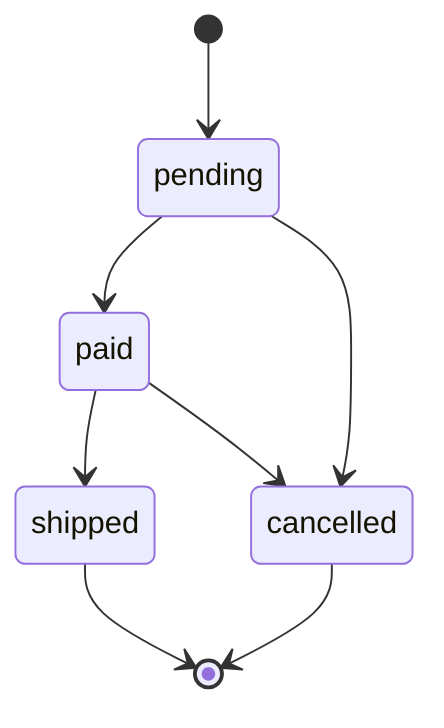

The ENUM only restricts the set of values; it does not enforce the transitions above. A `CHECK` cannot see the previous value either, so transitions belong in a trigger or in the application's `UPDATE ... WHERE status = 'paid'` guard.

**Domains** attach constraints to a base type once and reuse them. The starter's email rule lives in one place:

```sql
CREATE DOMAIN shop.email AS text
  CHECK (VALUE ~ '^[^@[:space:]]+@[^@[:space:]]+\.[^@[:space:]]+$');
```

A malformed address fails with `23514 check_violation` in any table that uses the domain. The regex is deliberately loose; real validation is sending a confirmation email.

**Range types** store an interval of values with inclusive or exclusive bounds: `int4range`, `int8range`, `numrange`, `daterange`, `tsrange`, `tstzrange`, plus multirange versions since 14 (`tstzmultirange` and so on). The default canonical form is half-open, `[lower, upper)`, which lets consecutive periods touch without overlapping.

```sql
SELECT tstzrange('2026-03-01', '2026-03-31') @> timestamptz '2026-03-31';   -- false: upper bound excluded
SELECT daterange('2026-01-01', '2026-02-01') -|- daterange('2026-02-01', '2026-03-01');  -- true: adjacent
SELECT int4range(1, 10) * int4range(5, 20);                                -- [5,10): intersection
SELECT datemultirange(daterange('2026-01-01','2026-01-10'), daterange('2026-01-05','2026-01-20'));
-- {[2026-01-01,2026-01-20)}: overlapping pieces are merged
```

| Range operator | Name | True when |
| :--- | :--- | :--- |
| `&&` | Overlaps | The ranges share at least one point |
| `@>` | Contains | The left range contains the right range or element |
| `<@` | Contained by | The left range lies entirely inside the right |
| `-\|-` | Adjacent | The ranges touch without overlapping |
| `<<` / `>>` | Strictly left / right of | No overlap, and one is entirely before the other |
| `*`, `+`, `-` | Intersection, union, difference | Return a new range (union fails if the result would have a gap) |

The starter's `shop.price_at()` function relies on the half-open rule: a promotion over `[2026-03-01, 2026-03-31)` applies on 15 March but not at midnight on 31 March, and the test suite checks both instants.

### 2.6 Constraints: NOT NULL, CHECK, UNIQUE, FOREIGN KEY & EXCLUDE

Constraints are checked by the server on every write, from every client, including ad-hoc fixes run by hand at 3 a.m. Application-side validation is for friendly messages; constraints are for correctness.

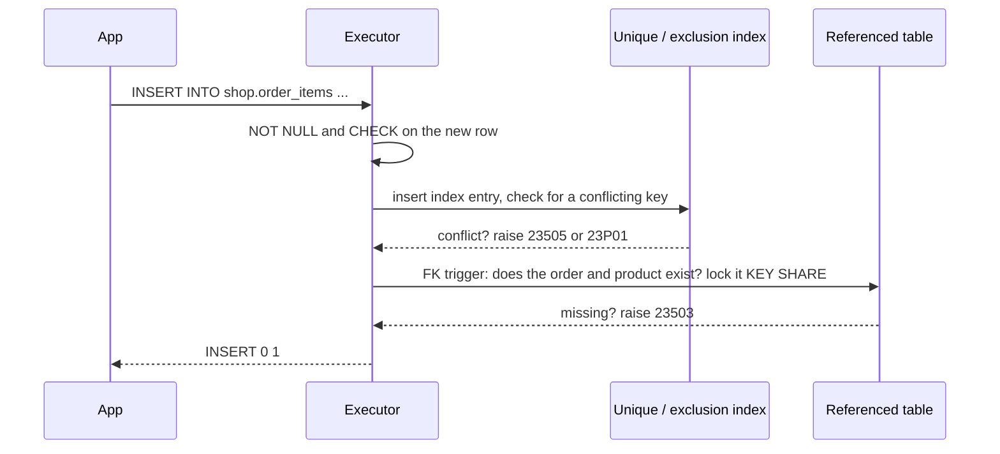

The starter's constraint tests document which SQLSTATE each rule raises. Client code can branch on these codes instead of parsing messages.

| Constraint in the starter | Bad write in [`tests/02_constraints_test.sql`](tests/02_constraints_test.sql) | SQLSTATE |
| --- | --- | --- |
| `price numeric(10,2) NOT NULL CHECK (price >= 0)` | price `-1` | `23514 check_violation` |
| `sku text NOT NULL UNIQUE CHECK (sku ~ '^[A-Z0-9-]{4,32}$')` | duplicate `BK-PG-001`; `bad sku` | `23505 unique_violation`; `23514` |
| `CREATE UNIQUE INDEX customers_email_lower_key ON shop.customers (lower(email))` | `ADA@example.com` when `ada@example.com` exists | `23505` |
| `email shop.email` (domain) | `not-an-email` | `23514` |
| `full_name text NOT NULL` | `NULL` | `23502 not_null_violation` |
| `customer_id ... REFERENCES shop.customers` | customer `999999` | `23503 foreign_key_violation` |
| `REFERENCES shop.customers ON DELETE RESTRICT` | delete a customer who has orders | `23001 restrict_violation` |
| `CHECK ((status = 'shipped') = (shipped_at IS NOT NULL))` | `shipped` with no date | `23514` |
| `status shop.order_status` | `'refunded'` | `22P02 invalid_text_representation` |
| `UNIQUE NULLS NOT DISTINCT (parent_id, name)` | a second top-level `Books` | `23505` |
| `EXCLUDE USING gist (product_id WITH =, active_during WITH &&)` | overlapping promotion | `23P01 exclusion_violation` |
| `GENERATED ALWAYS AS IDENTITY`, `GENERATED ALWAYS AS (...) STORED` | explicit id; writing `line_total` | `428C9 generated_always` |

Details that trip people up:

- **`CHECK` passes on NULL.** `CHECK (shipped_at >= ordered_at)` is true for rows with no `shipped_at`, because the expression is NULL and only `false` fails a check. Combine with `NOT NULL` when the value is required.
- **`UNIQUE` treats NULLs as distinct by default**, so `(NULL, 'Books')` could appear twice. `NULLS NOT DISTINCT` (15+) makes them collide, which is what a category tree needs at the top level.
- **Foreign keys do not create an index on the referencing column.** Without one, every delete or key update on the parent scans the child table. The starter indexes every FK column, and `tests/01_schema_test.sql` asserts it with a catalog query you can reuse.
- **`RESTRICT` versus `NO ACTION`.** Both refuse to delete a referenced parent. `NO ACTION` (the default) checks at the end of the statement, or at commit if the constraint is deferred, and raises `23503`. `RESTRICT` checks immediately, cannot be deferred, and raises `23001`.

| FK action | On parent delete or key update | Use for |
| --- | --- | --- |
| `NO ACTION` (default) | Error, checked at end of statement or deferred to commit | Most references |
| `RESTRICT` | Error, checked immediately | References that must never be orphaned, even mid-transaction (`orders.customer_id`) |
| `CASCADE` | Delete or update the children too | Composition: items that make no sense without their parent (`order_items.order_id`) |
| `SET NULL` / `SET DEFAULT` | Null or default the child column (15+: optionally only some columns) | Optional associations, such as "assigned agent" |

**Deferrable constraints** are checked at commit instead of after each statement. You need them when a transaction legitimately passes through an inconsistent state, such as swapping two unique positions:

```sql
CREATE TABLE playlist_items (
  playlist_id int, position int, track_id int,
  CONSTRAINT playlist_position_key UNIQUE (playlist_id, position) DEFERRABLE INITIALLY IMMEDIATE
);
BEGIN;
SET CONSTRAINTS playlist_position_key DEFERRED;
UPDATE playlist_items SET position = 2 WHERE playlist_id = 1 AND track_id = 10;  -- was 1
UPDATE playlist_items SET position = 1 WHERE playlist_id = 1 AND track_id = 20;  -- was 2
COMMIT;   -- checked here, and passes
```

Deferrable unique constraints cannot be used as `ON CONFLICT` arbiters, so keep them immediate unless you need the deferral.

**Exclusion constraints** generalise `UNIQUE` to any operator. "No two rows with equal `product_id` and overlapping `active_during`" is:

```sql
CONSTRAINT promotions_no_overlap
  EXCLUDE USING gist (product_id WITH =, active_during WITH &&)
```

GiST handles `&&` on ranges natively; `btree_gist` supplies the `=` operator class for `integer`. A hotel booking table uses the same pattern with `room_number WITH =, stay_period WITH &&`. PostgreSQL 18 can express this specific case as a temporal key, `PRIMARY KEY (product_id, active_during WITHOUT OVERLAPS)`, shown in [V.3](#v3-whats-new-in-postgresql-18).

### 2.7 Generated Columns: Stored vs Virtual

A generated column is computed from other columns of the same row. You cannot write to it, so it can never disagree with its inputs.

```sql
-- From sql/01_schema.sql
line_total numeric(12,2) GENERATED ALWAYS AS (quantity * unit_price) STORED,
```

```sql
-- PostgreSQL 18: VIRTUAL is the default and computes on read
CREATE TABLE shop_demo_orders (
  subtotal     numeric(12,2) NOT NULL CHECK (subtotal >= 0),
  tax_rate     numeric(5,4)  NOT NULL DEFAULT 0.0825 CHECK (tax_rate BETWEEN 0 AND 1),
  total_stored numeric(12,2) GENERATED ALWAYS AS (round(subtotal * (1 + tax_rate), 2)) STORED,
  total_virt   numeric(12,2) GENERATED ALWAYS AS (round(subtotal * (1 + tax_rate), 2)) VIRTUAL
);
```

| | `STORED` (12+) | `VIRTUAL` (18+, default) |
| --- | --- | --- |
| Computed | On `INSERT` and `UPDATE` | On every read |
| Disk space | Yes | None |
| Indexable | Yes | No (index the expression instead) |
| `ALTER TABLE ... ADD COLUMN` | Rewrites the table | Catalog change only |
| Expression limits | Immutable built-in or user functions | Immutable built-in functions and types only |
| Good for | Values you filter or aggregate constantly | Convenience columns that are read rarely or cheaply computed |

The expression must be immutable: `now()`, other tables and other generated columns are not allowed. For a timestamp of the last change, use a `DEFAULT now()` plus a trigger, or set it in the `UPDATE`.

### 2.8 Designing the Starter Schema

The starter models a shop in third normal form: each fact lives in exactly one place, and repeating groups (items of an order) get their own table.

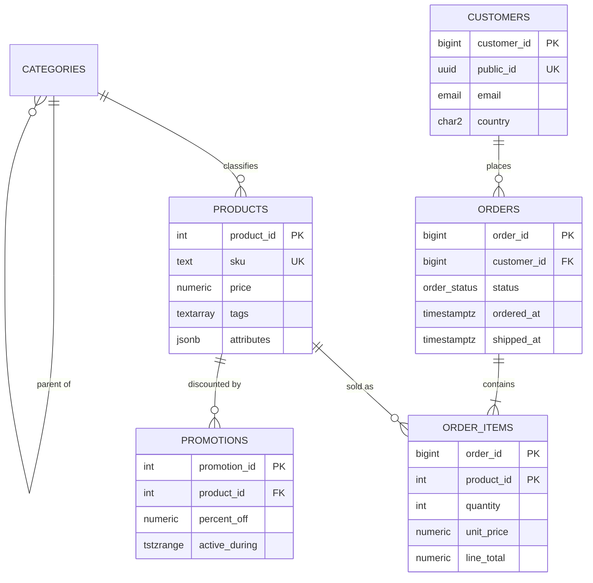

Design decisions worth copying:

- **`order_items.unit_price` duplicates `products.price` on purpose.** It records the price at the time of sale. Changing a product's price must not rewrite history, so this is not a normalisation error.
- **Composite primary key `(order_id, product_id)`** on `order_items` makes "the same product twice in one order" impossible; quantity carries the count. Its index also serves the FK on `order_id`, because `order_id` is the leading column.
- **Surrogate `bigint` keys internally, `uuidv7()` externally.** Joins stay on 8-byte integers; URLs show an ID that cannot be enumerated.
- **Business rules as named constraints** (`orders_shipped_has_date`, `promotions_no_overlap`). The name appears in the error message, which makes failures self-explanatory in logs.
- **Every FK column indexed**, checked by a test.

A line-by-line reading of the products table:

```sql
CREATE TABLE shop.products (
  product_id  integer       GENERATED ALWAYS AS IDENTITY PRIMARY KEY,
  category_id integer       NOT NULL REFERENCES shop.categories,
  sku         text          NOT NULL UNIQUE CHECK (sku ~ '^[A-Z0-9-]{4,32}$'),
  title       text          NOT NULL,
  price       numeric(10,2) NOT NULL CHECK (price >= 0),
  tags        text[]        NOT NULL DEFAULT '{}',
  attributes  jsonb         NOT NULL DEFAULT '{}' CHECK (jsonb_typeof(attributes) = 'object'),
  created_at  timestamptz   NOT NULL DEFAULT now()
);
CREATE INDEX products_category_id_idx ON shop.products (category_id);
CREATE INDEX products_tags_gin ON shop.products USING gin (tags);
CREATE INDEX products_attributes_gin ON shop.products USING gin (attributes jsonb_path_ops);
```

| Line | Role | What happens at runtime |
| :--- | :--- | :--- |
| `GENERATED ALWAYS AS IDENTITY PRIMARY KEY` | Surrogate key | Sequence supplies the value; the PK creates a unique B-tree `products_pkey`. |
| `REFERENCES shop.categories` | Parent link | With no column list it references the parent's primary key. Insert checks and locks the parent row `FOR KEY SHARE`. |
| `UNIQUE CHECK (sku ~ ...)` | Natural key | The unique index rejects duplicates; the regex rejects lower case and spaces. |
| `numeric(10,2) CHECK (price >= 0)` | Money | Exact decimal; negative prices fail with `23514`. |
| `text[] NOT NULL DEFAULT '{}'` | Tag list | Empty array instead of NULL, so `tags && ...` never meets NULL. |
| `jsonb ... CHECK (jsonb_typeof(attributes) = 'object')` | Flexible attributes | Arrays and scalars are rejected; only objects allowed. |
| `timestamptz DEFAULT now()` | Audit time | Transaction start time, in UTC internally. |
| GIN indexes on `tags` and `attributes` | Search | Serve `&&`/`@>` on arrays and `@>`/`@?` on JSON ([Stage 4](#4-stage-4-indexing-strategies--engine-internals)). |

For multi-tenant SaaS, the same ideas extend with a tenant column that leads every key, so a tenant's rows cluster together in each index and row-level security can filter by it:

```sql
CREATE TABLE app_products (
  tenant_id  bigint  NOT NULL,
  product_id bigint  GENERATED ALWAYS AS IDENTITY,
  sku        text    NOT NULL,
  price      numeric(10,2) NOT NULL CHECK (price >= 0),
  PRIMARY KEY (tenant_id, product_id),
  UNIQUE (tenant_id, sku)                 -- SKUs are unique per tenant, not globally
);
ALTER TABLE app_products ENABLE ROW LEVEL SECURITY;
CREATE POLICY tenant_isolation ON app_products
  USING (tenant_id = current_setting('app.tenant_id')::bigint);
```

### 2.9 Changing a Live Schema Safely

Every `ALTER TABLE` takes a lock, and most take `ACCESS EXCLUSIVE`, which blocks reads too. The lock itself is usually brief; the danger is waiting for it. While an `ALTER` waits behind one long-running query, every new query on the table queues behind the `ALTER`.

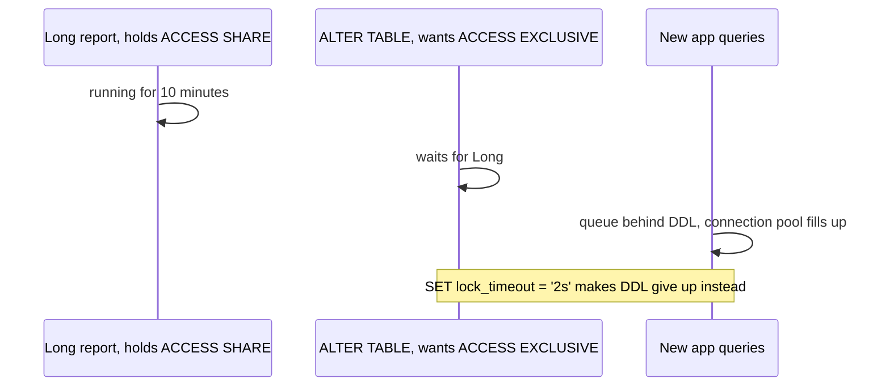

Always set a lock timeout for migrations and retry on failure:

```sql
SET lock_timeout = '2s';
SET statement_timeout = '15min';
ALTER TABLE shop.orders ADD COLUMN note text;
```

| Change | Lock and cost | Safe pattern |
| --- | --- | --- |
| `ADD COLUMN` with no default or a constant default | Catalog only (11+): instant | Safe as is. |
| `ADD COLUMN ... DEFAULT now()` or another volatile default | Rewrites the table | Add without default, set the default, backfill in batches. |
| `ADD COLUMN ... GENERATED ... STORED` | Rewrites the table | Use `VIRTUAL` (18) or a backfilled normal column. |
| `ALTER COLUMN TYPE` | Usually rewrites the table and rebuilds indexes | Exceptions: `varchar(n)` to larger `n` or to `text`. Otherwise add a new column and backfill. |
| `SET NOT NULL` | Full scan under `ACCESS EXCLUSIVE` | Add `CHECK (col IS NOT NULL) NOT VALID`, `VALIDATE` it, then `SET NOT NULL` uses the proven check and skips the scan (12+). |
| `ADD CONSTRAINT ... CHECK` or `FOREIGN KEY` | Full scan under a strong lock | `ADD ... NOT VALID`, then `VALIDATE CONSTRAINT` (weaker lock, does not block writes). |
| `CREATE INDEX` | Blocks writes for the whole build | `CREATE INDEX CONCURRENTLY` (cannot run inside a transaction block). |
| `DROP COLUMN` | Catalog only | Safe, but deploy code that stops using the column first. |

```sql
-- Add a foreign key to a large table without blocking writes during the scan
ALTER TABLE shop.order_items
  ADD CONSTRAINT order_items_product_fk2 FOREIGN KEY (product_id)
  REFERENCES shop.products NOT VALID;            -- new rows are checked from now on
ALTER TABLE shop.order_items
  VALIDATE CONSTRAINT order_items_product_fk2;   -- scans old rows with SHARE UPDATE EXCLUSIVE
```

PostgreSQL's DDL is transactional, so a migration file can run inside `BEGIN ... COMMIT` and roll back completely on error. The exceptions are `CREATE INDEX CONCURRENTLY`, `REINDEX CONCURRENTLY`, `ALTER TYPE ... ADD VALUE` in older versions, and `VACUUM`, which must run outside a transaction block.

### 2.10 Pitfalls

| Pitfall | Symptom | Fix |
| --- | --- | --- |
| `float8` or `real` for money | Totals off by a fraction of a cent; `0.1 + 0.2 = 0.3` is false | `numeric(p, s)` |
| `timestamp` without time zone for events | Reports shift by hours between servers or around DST changes | `timestamptz`, and convert with `AT TIME ZONE` only for display or bucketing |
| `serial` plus explicit IDs in inserts | Later: `ERROR: duplicate key value violates unique constraint "t_pkey"` | `GENERATED ALWAYS AS IDENTITY`; after bulk loads `ALTER TABLE ... ALTER COLUMN id RESTART WITH ...` |
| Expecting identity values to be gapless or in insert order | Missing invoice numbers; "order 2 is older than order 1" | Gaps are normal; sort by a timestamp; gapless numbers need a locked counter row. |
| `CHECK` assumed to reject NULL | Rows with NULL slip through `CHECK (qty > 0)` | Add `NOT NULL`. |
| Two NULLs in a `UNIQUE` column pair | Duplicate top-level categories | `UNIQUE NULLS NOT DISTINCT` (15+) or a partial unique index. |
| No index on a foreign-key column | Deleting one parent row takes seconds and locks many child rows | Index the referencing column (the starter's test detects missing ones). |
| Catching `23503` for an `ON DELETE RESTRICT` FK | The handler never runs: the error is `23001 restrict_violation` | Catch both, or use `NO ACTION`. |
| `EXCLUDE USING gist (id WITH =, ...)` without the extension | `ERROR: data type integer has no default operator class for access method "gist"` | `CREATE EXTENSION btree_gist;` |
| Removing an ENUM label | `ERROR: syntax error` (no such command) | Recreate the type, or use a lookup table for volatile lists. |
| Everything in `jsonb` | Bad row estimates, slow filters, no constraints | Promote frequently queried keys to columns; keep `jsonb` for the long tail. |
| Generated column with `now()` | `ERROR: generation expression is not immutable` | Use a default plus trigger, or compute in the query. |
| `ALTER TABLE` without `lock_timeout` in a migration | Application stalls behind a waiting `ACCESS EXCLUSIVE` lock | `SET lock_timeout = '2s'` and retry. |

### 2.11 Best Practices

- **Declare every invariant you can as a constraint**: the server checks it for every client, forever, and the SQLSTATE tells clients exactly what failed.
- **Name constraints explicitly**: `orders_shipped_has_date` in an error log explains itself; `orders_check1` does not.
- **Use `bigint` identity keys internally and `uuidv7()` where IDs leave the database**: compact joins inside, unguessable identifiers outside.
- **Store instants as `timestamptz` and bucket with an explicit `AT TIME ZONE`**: results then do not depend on the session's `TimeZone`.
- **Prefer half-open ranges `[start, end)`**: consecutive periods touch without overlap and no "end minus one second" hacks are needed.
- **Index every foreign-key column**: parent deletes and key updates otherwise scan the child.
- **Use domains for rules shared by several columns**: one definition, one place to change it.
- **Add constraints to big tables as `NOT VALID` and validate separately**: new writes are protected immediately and the scan does not block them.
- **Keep JSON for genuinely variable attributes**: columns get statistics, types and constraints; JSON gets none of that by default.

### 2.12 Hands-on Exercise

Add a `shop.reviews` table to the starter:

- one review per customer per product;
- `rating` from 1 to 5;
- an optional `body` of at most 2,000 characters;
- reviews disappear with their product, but a customer with reviews cannot be deleted;
- `created_at` defaults to the transaction time.

Then write three `pg_temp.expect_error(...)` calls that prove the rules, in a new file `tests/05_reviews_test.sql`.

Expected output: `bash scripts/run-tests.sh` prints three new `ok` lines, with SQLSTATEs `23514` (rating 6), `23505` (second review by the same customer for the same product) and `23001` (deleting a reviewing customer).

Solution: follow the patterns in [`sql/01_schema.sql`](sql/01_schema.sql) (`order_items` for the composite key, `orders.customer_id` for `ON DELETE RESTRICT`, `promotions.product_id` for `ON DELETE CASCADE`) and [`tests/02_constraints_test.sql`](tests/02_constraints_test.sql). Remember `SET ROLE shop_owner;` at the top of the DDL file so the default privileges apply, and an index on the `product_id` column.

[Back to top ⤴️](#-table-of-contents)

---

## 3. Stage 3: Querying: Joins, Aggregation, CTEs & Window Functions

SQL is declarative: you describe the result and the planner picks the algorithm. This stage teaches the pieces you combine to describe results precisely, from joins and grouping to recursive CTEs, window functions and `LATERAL`, and closes with writes that read (`ON CONFLICT`, `MERGE`). Prerequisites: Stages 1 and 2. Every example runs against the starter; [`sql/03_reports.sql`](sql/03_reports.sql) holds the views and functions and [`tests/03_queries_test.sql`](tests/03_queries_test.sql) asserts their exact output.

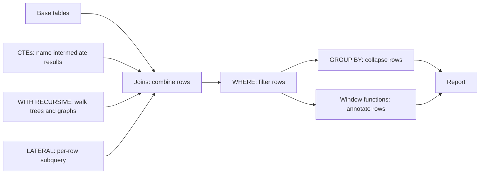

### 3.1 Logical Query Processing Order

A `SELECT` is written in one order and evaluated, logically, in another. The planner may reorder physical work, but the result must match this logical order, and it explains most "column does not exist" surprises.

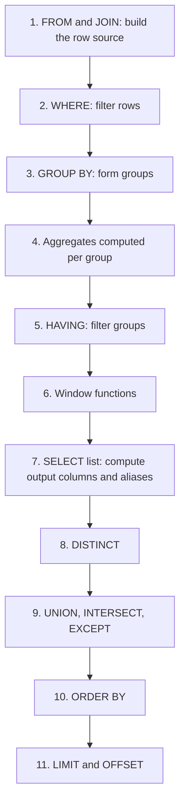

Consequences you will meet:

- An alias defined in `SELECT` cannot be used in `WHERE` (step 2 runs before step 7). Repeat the expression, or wrap the query in a subquery or CTE.
- `ORDER BY` runs after `SELECT`, so it can use aliases and output column positions.
- Aggregates cannot appear in `WHERE`; filter groups with `HAVING`.
- Window functions run after `WHERE` and `GROUP BY`. To filter on a window result (for example `row_number() = 1`), compute it in a subquery and filter outside.

```sql
-- Fails: ERROR:  column "total" does not exist
SELECT order_id, quantity * unit_price AS total FROM shop.order_items WHERE total > 100;

-- Works: compute in a subquery, filter outside
SELECT * FROM (
  SELECT order_id, quantity * unit_price AS total FROM shop.order_items
) t
WHERE total > 100;
```

### 3.2 Joins: Inner, Outer, Semi and Anti

| Join | Keeps | Starter example |
| --- | --- | --- |
| `INNER JOIN` | Pairs that match | Orders with their customer |
| `LEFT JOIN` | Every left row, matched right columns or NULLs | Every customer with order counts, including zero |
| `RIGHT JOIN` | Mirror of `LEFT`; rewrite as `LEFT` for readability | |
| `FULL JOIN` | Every row from both sides | Reconciling two lists |
| `CROSS JOIN` | Every combination | Calendars times products |
| Semi-join: `WHERE EXISTS (...)` | Left rows with at least one match, each once | Customers who ordered |
| Anti-join: `WHERE NOT EXISTS (...)` | Left rows with no match | Customers who never ordered |

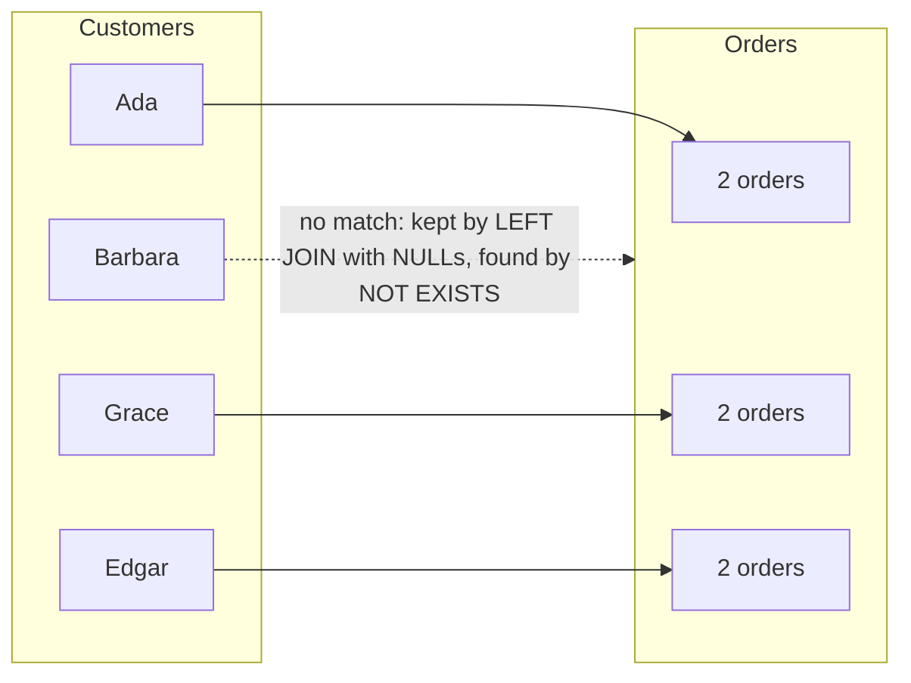

```sql
-- Order count per customer, zero included. count(o.order_id) counts non-NULL values,
-- so customers with no orders get 0, not 1.
SELECT c.full_name, count(o.order_id) AS orders
FROM shop.customers c
LEFT JOIN shop.orders o ON o.customer_id = c.customer_id
GROUP BY c.customer_id, c.full_name
ORDER BY c.full_name;

-- Anti-join: customers with no orders. Asserted in tests/03_queries_test.sql.
SELECT c.full_name
FROM shop.customers c
WHERE NOT EXISTS (SELECT FROM shop.orders o WHERE o.customer_id = c.customer_id);
-- Barbara Liskov
```

`USING (col)` joins on equally named columns and outputs the column once; `NATURAL JOIN` joins on every equally named column and silently changes meaning when someone adds a `created_at` to both tables, so avoid it.

**The `NOT IN` trap.** `x NOT IN (subquery)` is true only if `x` differs from every value. If the subquery returns a single NULL, each comparison with it is unknown, so the whole predicate is never true and the query returns no rows:

```sql
-- Returns nothing as soon as any order has a NULL customer_id (possible if the column were nullable)
SELECT full_name FROM shop.customers
WHERE customer_id NOT IN (SELECT customer_id FROM shop.orders);

-- Always correct, and planned as an efficient anti-join
SELECT full_name FROM shop.customers c
WHERE NOT EXISTS (SELECT FROM shop.orders o WHERE o.customer_id = c.customer_id);
```

A filter on the right-hand table of a `LEFT JOIN` belongs in the `ON` clause. Put it in `WHERE` and the NULL-extended rows are filtered away, turning the join back into an inner join:

```sql
-- Wrong: drops customers without paid orders
SELECT c.full_name, o.order_id
FROM shop.customers c LEFT JOIN shop.orders o ON o.customer_id = c.customer_id
WHERE o.status = 'paid';

-- Right: every customer, with paid orders where they exist
SELECT c.full_name, o.order_id
FROM shop.customers c LEFT JOIN shop.orders o
  ON o.customer_id = c.customer_id AND o.status = 'paid';
```

### 3.3 Aggregation: GROUP BY, FILTER, HAVING, GROUPING SETS, ROLLUP & CUBE

`GROUP BY` collapses rows into one row per group. Every output column must be grouped or aggregated, with one useful exception: if you group by a table's primary key, other columns of that table are allowed, because they are functionally dependent on it. The starter's `shop.order_totals` view relies on that:

```sql
CREATE VIEW shop.order_totals AS
SELECT o.order_id, o.customer_id, o.status, o.ordered_at,
       sum(oi.line_total)::numeric(12,2) AS order_total
FROM shop.orders o
JOIN shop.order_items oi USING (order_id)
GROUP BY o.order_id;           -- PK: customer_id, status and ordered_at may be selected
```

`FILTER` restricts one aggregate without affecting the others, which replaces the old `sum(CASE WHEN ... THEN ... END)` idiom:

```sql
SELECT count(*)                                       AS all_orders,
       count(*) FILTER (WHERE status = 'cancelled')   AS cancelled,
       sum(order_total) FILTER (WHERE status IN ('paid', 'shipped')) AS revenue
FROM shop.order_totals;
-- all_orders 6 | cancelled 1 | revenue 506.00
```

`HAVING` filters after grouping: `GROUP BY customer_id HAVING sum(order_total) > 200`.

Useful aggregates beyond `count`/`sum`/`avg`: `string_agg(x, ', ' ORDER BY x)`, `array_agg`, `jsonb_agg` and `jsonb_object_agg` (build API payloads in SQL), `bool_and`/`bool_or`, `percentile_cont(0.5) WITHIN GROUP (ORDER BY x)` (median), `mode() WITHIN GROUP (ORDER BY x)`, and `any_value(x)` (16+).

**Several groupings in one pass.** `GROUPING SETS` computes several `GROUP BY`s over the same input; `ROLLUP` and `CUBE` are shorthands. The starter's `shop.revenue_rollup` view produces detail, subtotal and grand-total rows:

```sql
CREATE VIEW shop.revenue_rollup AS
WITH paid AS (
  SELECT c.country,
         date_trunc('month', t.ordered_at AT TIME ZONE 'UTC')::date AS month,
         t.order_total
  FROM shop.order_totals t
  JOIN shop.customers c USING (customer_id)
  WHERE t.status IN ('paid', 'shipped')
)
SELECT country, month,
       GROUPING(country, month) AS grouping_level,
       sum(order_total)::numeric(12,2) AS revenue
FROM paid
GROUP BY ROLLUP (country, month);
```

```text
 country |   month    | grouping_level | revenue
---------+------------+----------------+---------
 GB      | 2026-01-01 |              0 |  119.00
 GB      | 2026-02-01 |              0 |  129.00
 GB      |            |              1 |  248.00
 US      | 2026-01-01 |              0 |   79.00
 US      | 2026-03-01 |              0 |  179.00
 US      |            |              1 |  258.00
         |            |              3 |  506.00
```

`GROUPING(country, month)` returns a bitmask with one bit per argument (the last argument is the lowest bit), set when that column was rolled up. Use it rather than `IS NULL` to tell a subtotal row from a group whose key really is NULL.

| Grouping clause | Groupings computed | Typical use |
| :--- | :--- | :--- |
| `GROUPING SETS ((a), (b))` | `(a)` and `(b)` separately | Two independent breakdowns in one scan |
| `ROLLUP (a, b, c)` | `(a,b,c)`, `(a,b)`, `(a)`, `()` | Hierarchies: year > month > day, country > city |
| `CUBE (a, b)` | All 2^n combinations: `(a,b)`, `(a)`, `(b)`, `()` | Exploratory cross-tabs |

### 3.4 Subqueries and Common Table Expressions

A CTE (`WITH name AS (...)`) names an intermediate result so a complex query reads top to bottom. Since PostgreSQL 12 the planner inlines a non-recursive, side-effect-free CTE that is referenced exactly once, so it optimises exactly like a subquery. A CTE referenced more than once is computed once and reused. You can override either choice:

```sql
-- Inlined: the planner pushes "monthly_fee > 100" into the CTE and can use an index
WITH active_subscriptions AS (
  SELECT customer_id, plan_name, monthly_fee
  FROM subscriptions
  WHERE status = 'active'
)
SELECT * FROM active_subscriptions WHERE monthly_fee > 100;

-- MATERIALIZED: computed once into a work table; outer filters are not pushed in.
-- Use it as an optimisation fence when the inlined plan is worse, or to evaluate
-- an expensive function once.
WITH high_volume AS MATERIALIZED (
  SELECT customer_id, count(*) AS total_orders
  FROM shop.orders
  GROUP BY customer_id
)
SELECT * FROM high_volume WHERE total_orders > 1;

-- NOT MATERIALIZED: force inlining even when referenced twice
WITH c AS NOT MATERIALIZED (SELECT * FROM shop.customers)
SELECT * FROM c a JOIN c b ON a.country = b.country AND a.customer_id < b.customer_id;
```

| Form | Evaluated | Outer predicates pushed in | Use for |
| --- | --- | --- | --- |
| Scalar subquery `(SELECT ...)` | Per row (or once if uncorrelated) | Not applicable | One value, such as a lookup in a `SELECT` list |
| `IN` / `EXISTS` subquery | As a semi-join | Yes | Membership tests |
| Derived table `FROM (SELECT ...) t` | Inlined | Yes | Filtering on window results or aliases |
| CTE, referenced once | Inlined (12+) | Yes | Readability |
| CTE, referenced twice or `MATERIALIZED` | Once, stored | No | Reuse, deliberate fences |
| Data-modifying CTE | Exactly once, always | No | Moving rows between tables ([3.8](#38-upserts-merge-and-data-modifying-ctes)) |

### 3.5 Recursive CTEs: Trees and Graphs

`WITH RECURSIVE` has two parts joined by `UNION ALL`: an anchor query that produces the starting rows, and a recursive query that references the CTE itself and produces the next level from the previous one. Evaluation repeats until the recursive part returns no rows.

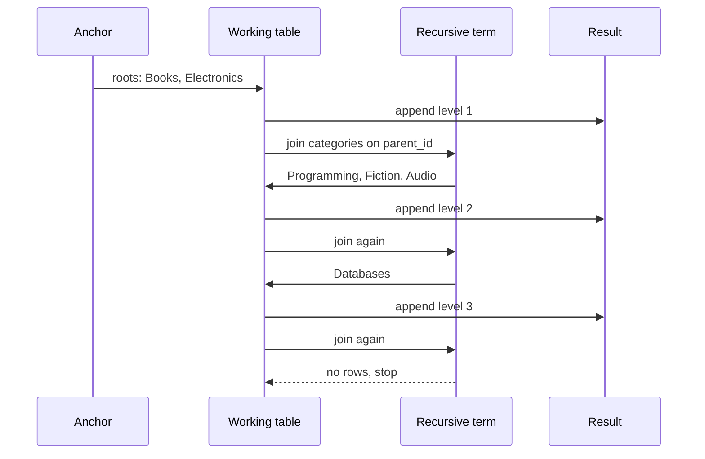

The starter's `shop.category_paths` view builds the full path of every category:

```sql
CREATE VIEW shop.category_paths AS
WITH RECURSIVE tree AS (
  SELECT category_id, parent_id, name, 1 AS depth, name AS path
  FROM shop.categories
  WHERE parent_id IS NULL
  UNION ALL
  SELECT c.category_id, c.parent_id, c.name, t.depth + 1, t.path || ' > ' || c.name
  FROM shop.categories c
  JOIN tree t ON c.parent_id = t.category_id
) CYCLE category_id SET is_cycle USING visited
SELECT category_id, parent_id, name, depth, path
FROM tree
WHERE NOT is_cycle;
```

```text
 category_id | depth |              path
-------------+-------+---------------------------------
           1 |     1 | Books
           3 |     2 | Books > Fiction
           4 |     2 | Books > Programming
           6 |     3 | Books > Programming > Databases
           2 |     1 | Electronics
           5 |     2 | Electronics > Audio
```

| Line / API | Role | What happens at runtime |
| :--- | :--- | :--- |
| `WHERE parent_id IS NULL` | Anchor | Seeds the working table with the roots. |
| `UNION ALL` | Combine levels | `UNION` would also de-duplicate, which costs a hash per iteration and can mask bugs. |
| `JOIN tree t ON c.parent_id = t.category_id` | Recursive step | Sees only the rows produced by the previous iteration, not the whole result. |
| `t.depth + 1`, `t.path \|\| ' > ' \|\| c.name` | Carried state | Each level derives its values from its parent's row. |
| `CYCLE category_id SET is_cycle USING visited` | Loop guard (14+) | Tracks visited IDs in an array column; a row that revisits an ID is marked `is_cycle = true` and not expanded further. |

Before 14 the same guard was written by hand: carry `ARRAY[id] AS path`, append with `path || e.id`, and add `WHERE NOT e.id = ANY(path)` to the recursive term. The `SEARCH DEPTH FIRST BY name SET ord` clause (also 14+) adds an ordering column for printing a tree in depth-first order.

Recursion also works upwards. `shop.category_revenue` builds an "ancestry" relation (every category paired with itself and each of its ancestors) and then sums sales up the tree, so `Books` includes sales from `Databases` two levels below:

```sql
WITH RECURSIVE ancestry AS (
  SELECT category_id AS leaf_id, category_id AS ancestor_id FROM shop.categories
  UNION ALL
  SELECT a.leaf_id, c.parent_id
  FROM ancestry a JOIN shop.categories c ON c.category_id = a.ancestor_id
  WHERE c.parent_id IS NOT NULL
)
SELECT * FROM ancestry ORDER BY leaf_id, ancestor_id;
```

The same technique walks an org chart. This version from the earlier guide shows the manual cycle guard and indented output:

```sql
WITH RECURSIVE org_hierarchy AS (
  SELECT id, name, manager_id, 1 AS level, ARRAY[id] AS path
  FROM employees
  WHERE manager_id IS NULL
  UNION ALL
  SELECT e.id, e.name, e.manager_id, oh.level + 1, oh.path || e.id
  FROM employees e
  JOIN org_hierarchy oh ON e.manager_id = oh.id
  WHERE NOT e.id = ANY (oh.path)               -- stop at cycles
)
SELECT repeat('  ', level - 1) || name AS org_chart, path
FROM org_hierarchy
ORDER BY path;
```

For general graphs (many parents per node), recursive CTEs find paths but can explode combinatorially. Bound the depth (`WHERE depth < 10`), keep `UNION ALL` plus a cycle guard, and consider the `ltree` extension for read-heavy trees, or a closure table maintained on write.

### 3.6 Window Functions: Ranking, Offsets & Frames

A window function computes a value for each row from a set of related rows (its window) without collapsing them. `GROUP BY` answers "total per customer"; a window answers "each order, with the customer's running total next to it".

```sql
CREATE VIEW shop.customer_order_history AS
SELECT t.customer_id,
       t.order_id,
       t.ordered_at,
       t.order_total,
       row_number()       OVER w AS order_seq,
       sum(t.order_total) OVER (w ROWS BETWEEN UNBOUNDED PRECEDING AND CURRENT ROW) AS running_total,
       lag(t.order_total) OVER w AS previous_total,
       dense_rank()       OVER (ORDER BY t.order_total DESC) AS overall_rank
FROM shop.order_totals t
WHERE t.status <> 'cancelled'
WINDOW w AS (PARTITION BY t.customer_id ORDER BY t.ordered_at);
```

```text
 customer_id | order_id | order_total | order_seq | running_total | previous_total | overall_rank
-------------+----------+-------------+-----------+---------------+----------------+--------------
           1 |        2 |      119.00 |         1 |        119.00 |                |            3
           1 |        1 |      129.00 |         2 |        248.00 |         119.00 |            2
           2 |        4 |       79.00 |         1 |         79.00 |                |            4
           3 |        6 |      179.00 |         1 |        179.00 |                |            1
           3 |        5 |       35.00 |         2 |        214.00 |         179.00 |            5
```

| SQL construct | Operation | What it does here |
| :--- | :--- | :--- |
| `WINDOW w AS (PARTITION BY customer_id ORDER BY ordered_at)` | Named window | Defined once, reused by three functions; also lets the executor sort once. |
| `PARTITION BY customer_id` | Window slicing | Each customer is computed independently; rows are not collapsed. |
| `row_number()` | Sequence | 1, 2, 3 per partition, no ties. Use for de-duplication ("keep the latest row"). |
| `sum(...) OVER (w ROWS BETWEEN UNBOUNDED PRECEDING AND CURRENT ROW)` | Running total | Copies `w` and adds an explicit frame: from the partition start to this row. |
| `lag(order_total)` | Offset | Value from the previous row in the partition, NULL for the first. `lead()` looks forward. |
| `dense_rank() OVER (ORDER BY order_total DESC)` | Ranking | A separate, unpartitioned window over all rows. |

**Ranking functions on ties.** For values 50, 40, 40, 30:

| Function | Result | Meaning |
| --- | --- | --- |
| `row_number()` | 1, 2, 3, 4 | Arbitrary order among ties unless `ORDER BY` breaks them |
| `rank()` | 1, 2, 2, 4 | Ties share a rank, then a gap |
| `dense_rank()` | 1, 2, 2, 3 | Ties share a rank, no gap |
| `percent_rank()` | 0, 0.333, 0.333, 1 | `(rank - 1) / (rows - 1)` |
| `ntile(2)` | 1, 1, 2, 2 | Splits the partition into n buckets |

**Frames.** Aggregates used as window functions (`sum`, `avg`, `count`, `first_value`, `last_value`) operate on a frame inside the partition. The default frame with `ORDER BY` is `RANGE BETWEEN UNBOUNDED PRECEDING AND CURRENT ROW`, and `RANGE` includes all peers (rows with the same `ORDER BY` value). That is why a running total over duplicate dates jumps by both rows at once, and why `last_value()` usually returns the current row instead of the partition's last row.

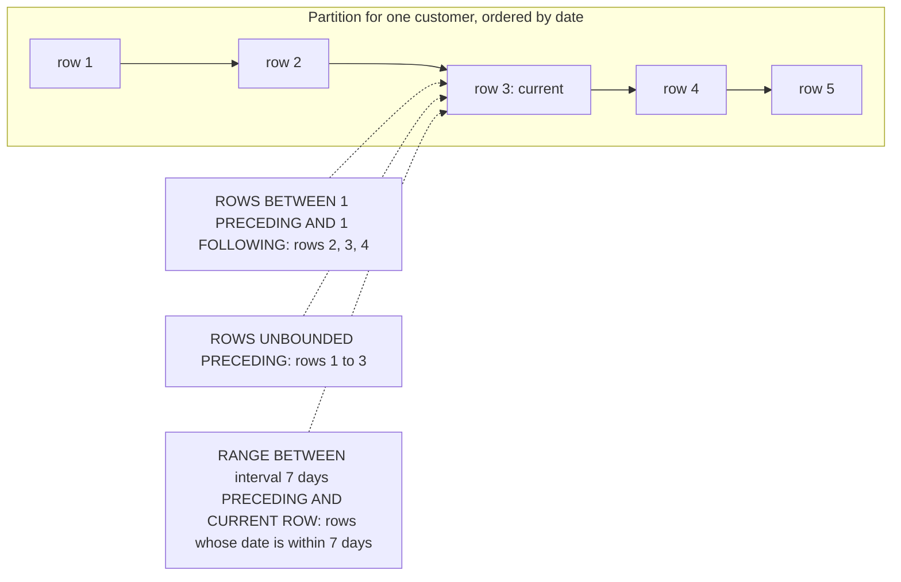

| Frame mode | Unit | Example |
| --- | --- | --- |
| `ROWS` | Physical rows | `ROWS BETWEEN 6 PRECEDING AND CURRENT ROW`: 7-row moving average |
| `RANGE` | Values of the single `ORDER BY` column | `RANGE BETWEEN interval '7 days' PRECEDING AND CURRENT ROW`: last 7 calendar days, however many rows |
| `GROUPS` | Peer groups | `GROUPS BETWEEN 1 PRECEDING AND CURRENT ROW`: this date's rows plus the previous date's |

A frame can also `EXCLUDE CURRENT ROW`, `EXCLUDE TIES` or `EXCLUDE GROUP`, which helps when comparing a row with its neighbours' average.

```sql
-- A payroll example with every ranking function and a running total per department
SELECT employee_id, department_id, salary,
       row_number() OVER dept AS row_num,
       rank()       OVER dept AS rank_with_gaps,
       dense_rank() OVER dept AS dense_rank,
       sum(salary)  OVER (dept ROWS BETWEEN UNBOUNDED PRECEDING AND CURRENT ROW) AS cumulative_salary,
       salary - avg(salary) OVER (PARTITION BY department_id) AS diff_from_dept_avg
FROM employees
WINDOW dept AS (PARTITION BY department_id ORDER BY salary DESC);

-- Keep only the newest row per key: window in a subquery, filter outside
SELECT * FROM (
  SELECT o.*, row_number() OVER (PARTITION BY customer_id ORDER BY ordered_at DESC) AS rn
  FROM shop.orders o
) latest
WHERE rn = 1;
```

For "newest row per key", PostgreSQL also has `DISTINCT ON`, which is shorter and often faster:

```sql
SELECT DISTINCT ON (customer_id) customer_id, order_id, ordered_at
FROM shop.orders
ORDER BY customer_id, ordered_at DESC;   -- the first row of each customer_id group wins
```

### 3.7 LATERAL Joins and Top-N per Group

A subquery in `FROM` normally cannot see other `FROM` items. Marking it `LATERAL` lets it reference columns of items to its left, so it runs once per left row, like a `for each` loop. Set-returning functions in `FROM` are implicitly lateral.

The starter's `shop.top_products(n)` returns the n best sellers in every category:

```sql
CREATE FUNCTION shop.top_products(per_category integer)
RETURNS TABLE (category_name text, product_sku text, units_sold bigint)
LANGUAGE sql STABLE
BEGIN ATOMIC
  SELECT c.name, top.sku, top.qty
  FROM shop.categories c
  CROSS JOIN LATERAL (
    SELECT p.sku, sum(oi.quantity) AS qty
    FROM shop.products p
    JOIN shop.order_items oi ON oi.product_id = p.product_id
    JOIN shop.orders o       ON o.order_id = oi.order_id
    WHERE p.category_id = c.category_id
      AND o.status IN ('paid', 'shipped')
    GROUP BY p.sku
    ORDER BY qty DESC, p.sku
    LIMIT per_category
  ) AS top
  ORDER BY c.name, top.qty DESC, top.sku;
END;
```

```sql
SELECT * FROM shop.top_products(1);
```

```text
 category_name | product_sku | units_sold
---------------+-------------+------------
 Audio         | EL-HP-005   |          1
 Databases     | BK-PG-001   |          3
 Fiction       | BK-FIC-004  |          2
 Programming   | BK-GO-003   |          1
```

| Line / API | Role | What happens at runtime |
| :--- | :--- | :--- |
| `LANGUAGE sql STABLE` | Volatility | `STABLE` promises no writes and the same result within one statement, so the planner may inline or cache. |
| `BEGIN ATOMIC ... END` | SQL-standard body (14+) | Parsed at `CREATE` time: dependencies are tracked, so dropping a referenced table fails instead of breaking the function later. |
| `CROSS JOIN LATERAL (...)` | Per-row subquery | Runs once per category; categories with no sales produce no rows. Use `LEFT JOIN LATERAL (...) ON true` to keep them. |
| `WHERE p.category_id = c.category_id` | Correlation | References the outer row; only allowed because of `LATERAL`. |
| `ORDER BY qty DESC, p.sku LIMIT per_category` | Top N | The tie-breaker on `sku` makes the result deterministic; Audio's two products tie on 1 unit. |

`LATERAL` with `LIMIT` is the fastest top-N-per-group pattern when there is an index matching the inner `ORDER BY` (for example `(customer_id, ordered_at DESC)` for "latest 3 orders per customer"): each iteration reads only N index entries. A `row_number()` window must number every row first. Without a suitable index the window version is often faster, so check with `EXPLAIN`.

```sql
-- Each customer with their 3 most recent orders, including customers with none
SELECT c.full_name, recent.order_id, recent.ordered_at
FROM shop.customers c
LEFT JOIN LATERAL (
  SELECT o.order_id, o.ordered_at
  FROM shop.orders o
  WHERE o.customer_id = c.customer_id
  ORDER BY o.ordered_at DESC
  LIMIT 3
) recent ON true
ORDER BY c.full_name, recent.ordered_at DESC;
```

### 3.8 Upserts, MERGE and Data-Modifying CTEs

**`INSERT ... ON CONFLICT`** handles "insert, or update if it exists" atomically, using a unique index as the arbiter. It is safe under concurrency: two sessions inserting the same key cannot both insert.

```sql
INSERT INTO shop.products (category_id, sku, title, price)
SELECT category_id, 'BK-PG-001', 'PostgreSQL Internals, 2nd ed.', 55.00
FROM shop.products WHERE sku = 'BK-PG-001'
ON CONFLICT (sku) DO UPDATE
  SET title = EXCLUDED.title,
      price = EXCLUDED.price
  WHERE shop.products.price IS DISTINCT FROM EXCLUDED.price   -- skip no-op updates
RETURNING product_id, (xmax = 0) AS inserted;
```

`EXCLUDED` is the row that was proposed for insertion. The `WHERE` on `DO UPDATE` avoids writing a new row version when nothing changed. `(xmax = 0) AS inserted` is a widely used trick to tell inserts from updates in `RETURNING`; in 18 the documented way is `RETURNING old.price IS NULL AS inserted`.

**`MERGE`** (15+) compares a source with a target and runs different actions for matched and unmatched rows. Since 17 it supports `RETURNING` and `WHEN NOT MATCHED BY SOURCE`, which makes it a full synchronisation statement.

```mermaid
flowchart TD
    S["Source row: price feed"] --> Q{"Matches a target row ON sku?"}
    Q -->|"yes and price changed"| U["WHEN MATCHED AND ...: UPDATE"]
    Q -->|"yes, same price"| N["DO NOTHING"]
    Q -->|"no"| I["WHEN NOT MATCHED: INSERT"]
    T["Target row with no source row"] --> D["WHEN NOT MATCHED BY SOURCE: DELETE or UPDATE (17+)"]
```

```sql
CREATE TEMP TABLE price_feed (sku text PRIMARY KEY, price numeric(10,2));
INSERT INTO price_feed VALUES ('BK-PG-001', 52.00), ('BK-SQL-002', 35.00);

MERGE INTO shop.products AS p
USING price_feed AS f ON p.sku = f.sku
WHEN MATCHED AND p.price <> f.price THEN
  UPDATE SET price = f.price
WHEN NOT MATCHED THEN
  DO NOTHING                        -- new SKUs need a category; handled elsewhere
RETURNING merge_action(), p.sku, p.price;
```

`ON CONFLICT` versus `MERGE`: `ON CONFLICT` is the concurrency-safe upsert for single rows and batches keyed by a unique index. `MERGE` handles more cases (delete, conditional actions, no unique index required), but under concurrent inserts of the same new key it can fail with a unique violation, because it does not use the speculative insertion that `ON CONFLICT` uses. Use `ON CONFLICT` for API upserts and `MERGE` for batch synchronisation.

**Data-modifying CTEs** run `INSERT`, `UPDATE` or `DELETE` inside `WITH` and pass their `RETURNING` rows on. All sub-statements see the same snapshot and run exactly once, so this moves rows atomically:

```sql
-- Archive cancelled orders in one statement
CREATE TABLE IF NOT EXISTS shop.orders_archive (LIKE shop.orders);

WITH moved AS (
  DELETE FROM shop.orders
  WHERE status = 'cancelled' AND ordered_at < now() - interval '90 days'
  RETURNING *
)
INSERT INTO shop.orders_archive SELECT * FROM moved;
```

Sub-statements cannot see each other's changes to the same table (they share a snapshot), so do not update the same row twice in one statement.

### 3.9 Set Operations, DISTINCT ON and Pagination

`UNION` removes duplicates (a sort or hash over the whole result); `UNION ALL` does not and is much cheaper. `INTERSECT` and `EXCEPT` compare whole rows and treat NULLs as equal, unlike `=`.

```sql
-- Products sold in January but not in February
SELECT oi.product_id FROM shop.order_items oi JOIN shop.orders o USING (order_id)
WHERE o.ordered_at >= '2026-01-01' AND o.ordered_at < '2026-02-01'
EXCEPT
SELECT oi.product_id FROM shop.order_items oi JOIN shop.orders o USING (order_id)
WHERE o.ordered_at >= '2026-02-01' AND o.ordered_at < '2026-03-01';
```

Note the half-open date filter (`>= start AND < end`). `BETWEEN '2026-01-01' AND '2026-01-31'` on a `timestamptz` misses everything after midnight on the 31st.

**Pagination.** `OFFSET` reads and discards every skipped row, so page 10,000 costs 10,000 pages of work, and rows shift between pages when data changes. Keyset (seek) pagination remembers the last row of the previous page and continues after it, using an index on the sort key:

```sql
-- Page 1
SELECT order_id, ordered_at FROM shop.orders
ORDER BY ordered_at DESC, order_id DESC
LIMIT 20;

-- Next page: pass the last row's (ordered_at, order_id) back in.
-- The row comparison matches a composite index on (ordered_at DESC, order_id DESC).
SELECT order_id, ordered_at FROM shop.orders
WHERE (ordered_at, order_id) < ('2026-02-03 15:30+00', 1)
ORDER BY ordered_at DESC, order_id DESC
LIMIT 20;
```

| | `LIMIT ... OFFSET` | Keyset |
| --- | --- | --- |
| Cost of deep pages | Grows with the offset | Constant with an index |
| Stable under inserts | No: rows repeat or are skipped | Yes |
| Jump to page N | Yes | No, only next and previous |
| Requirement | None | A unique, indexed sort key (add the PK as tie-breaker) |

### 3.10 Pitfalls

| Pitfall | Symptom | Fix |
| --- | --- | --- |
| Using a `SELECT` alias in `WHERE` | `ERROR: column "total" does not exist` | Repeat the expression or filter in an outer query ([3.1](#31-logical-query-processing-order)). |
| `NOT IN (subquery)` where the subquery can return NULL | Query silently returns zero rows | `NOT EXISTS`. |
| Filtering the right table of a `LEFT JOIN` in `WHERE` | Unmatched left rows vanish | Move the condition into `ON`. |
| `count(*)` after a `LEFT JOIN` | Customers without orders show 1 | `count(right_table.pk)` counts only matches. |
| Joining two one-to-many tables, then summing | Totals multiplied (fan-out) | Aggregate each child in a subquery or CTE first, then join. |
| Non-grouped column in `SELECT` | `ERROR: column "o.status" must appear in the GROUP BY clause or be used in an aggregate function` | Group by it, aggregate it, or group by the table's primary key. |
| `last_value()` returns the current row | Wrong "last" values | Default frame ends at the current row; add `ROWS BETWEEN UNBOUNDED PRECEDING AND UNBOUNDED FOLLOWING`. |
| Running total jumps by two rows at once | Duplicates in the `ORDER BY` column share a `RANGE` frame | Use `ROWS`, or add a unique tie-breaker to `ORDER BY`. |
| Filtering on a window function in `WHERE` | `ERROR: window functions are not allowed in WHERE` | Compute in a subquery, filter outside. |
| Recursive CTE on data with a cycle | Query never finishes, temp files grow | `CYCLE` clause (14+) or a manual path array guard, plus a depth limit. |
| `UNION` where `UNION ALL` was meant | Slow query and silently removed duplicate rows | Use `UNION ALL` unless you need de-duplication. |
| `BETWEEN` on timestamps for a date range | Last day partly missing | `>= start AND < next_start`. |
| `ORDER BY ... LIMIT` without a unique tie-breaker | Rows appear on two pages or on none | Add the primary key to the `ORDER BY`. |
| `MERGE` for concurrent upserts | Occasional `23505 unique_violation` under load | `INSERT ... ON CONFLICT`. |
| Updating the same row twice via data-modifying CTEs | Only one update takes effect | Combine the changes into one statement. |

### 3.11 Best Practices

- **Prefer `EXISTS` / `NOT EXISTS` for membership**: correct with NULLs and planned as semi- and anti-joins.
- **Aggregate before joining when tables fan out**: avoids multiplied sums and reduces the rows that are joined.
- **Use `FILTER` instead of `CASE` inside aggregates**: shorter and states the intent.
- **Name repeated windows with a `WINDOW` clause**: one definition, and the executor sorts once for all functions that share it.
- **State frames explicitly when they matter**: the `RANGE` default with peers surprises people.
- **Give every `ORDER BY ... LIMIT` a unique tie-breaker**: deterministic results and stable pagination.
- **Use `LATERAL` plus an index for top-N per group on large tables**: each group reads only N index entries.
- **Use `ON CONFLICT` for upserts and `MERGE` for batch syncs**: each is the right tool for its concurrency profile.
- **Keyset-paginate anything users can scroll deeply**: constant cost per page.
- **Put reports in views or SQL functions with `BEGIN ATOMIC`**: one tested definition, dependencies tracked by the catalog.
- **Use half-open intervals for time filters**: `>= start AND < end` never double-counts or drops boundary rows.

### 3.12 Hands-on Exercise

Write a view `shop.monthly_customer_spend` that returns, for each customer and each calendar month (UTC) in which they had paid or shipped orders:

- `customer_id`, `month`, `spend` (sum of order totals),
- `prev_month_spend` (the spend in the customer's previous active month, NULL for the first),
- `spend_rank` within the month (1 = highest spend that month, ties share a rank without gaps).

Add assertions to a new file `tests/06_monthly_spend_test.sql`.

Expected output for the seed data:

```text
 customer | month      | spend  | prev_month_spend | spend_rank
----------+------------+--------+------------------+-----------
 Ada      | 2026-01-01 | 119.00 |                  |          1
 Grace    | 2026-01-01 |  79.00 |                  |          2
 Ada      | 2026-02-01 | 129.00 |           119.00 |          1
 Edgar    | 2026-03-01 | 179.00 |                  |          1
```

Solution: start from `shop.order_totals` and the month bucketing in `shop.revenue_rollup`, group by customer and month, then apply `lag()` partitioned by customer and `dense_rank()` partitioned by month, all in [`sql/03_reports.sql`](sql/03_reports.sql) style. Edgar's pending March order (35.00) must not count.

[Back to top ⤴️](#-table-of-contents)

---

## 4. Stage 4: Indexing Strategies & Engine Internals

Indexes trade write cost and disk space for faster reads. This stage covers the index access methods PostgreSQL ships with, the special index shapes (partial, expression, covering), how to build and rebuild them without blocking writes, and how to read the plans that tell you whether an index is used.

### 4.1 Index Type Taxonomy: B-Tree, Hash, GiST, SP-GiST, GIN, BRIN

PostgreSQL has six built-in index access methods, each suited to different operators:

```mermaid
flowchart TD
    Index["PostgreSQL index access methods"] --> BTree["B-tree, the default: =, <, <=, >=, >, BETWEEN, IN, IS NULL, sorting"]
    Index --> Hash["Hash: = only"]
    Index --> GiST["GiST: ranges, geometry, nearest neighbour, exclusion constraints"]
    Index --> SPGiST["SP-GiST: unbalanced partitioned spaces such as quadtrees and tries"]
    Index --> GIN["GIN: inverted index for jsonb, arrays, full-text search"]
    Index --> BRIN["BRIN: min and max per block range, for naturally ordered big tables"]
```

| Access method | Best suited for | Size relative to the table | Write overhead |
| :--- | :--- | :--- | :--- |
| **B-tree** | Primary keys, integers, timestamps, text with `=`, `<`, `>`, `ORDER BY` | Medium | Moderate |
| **Hash** | Equality only on long values; WAL-logged and crash-safe since 10 | Small to medium | Light |
| **GiST** | Range overlap (`&&`), PostGIS geometry, KNN (`ORDER BY point <-> point`) | Medium | Moderate |
| **SP-GiST** | Non-uniform data: IP prefixes, phone numbers, points in quadtrees | Medium | Moderate |
| **GIN** | `jsonb` containment (`@>`), array overlap (`&&`), `tsvector` search | Large (can exceed the table) | Heavy; buffered through a pending list when `fastupdate` is on |
| **BRIN** | Append-only logs and time series where physical order follows the column | Tiny (kilobytes for gigabytes of table) | Near zero |

### 4.2 GIN (Generalized Inverted Index) for JSONB & Full-Text Search

A GIN index maps each key, value or element to the list of rows (TIDs) that contain it, like the index at the back of a book.

```sql
-- Default jsonb_ops: supports @>, ?, ?|, ?&, @?, @@
CREATE INDEX idx_products_attributes ON shop.products USING gin (attributes);

-- jsonb_path_ops: smaller and faster for containment; supports @>, @?, @@ only (the starter uses this)
CREATE INDEX idx_products_path_ops ON shop.products USING gin (attributes jsonb_path_ops);

-- Index-assisted query
SELECT * FROM shop.products WHERE attributes @> '{"color": "black", "wireless": false}';
```

On a six-row table the planner rightly prefers a sequential scan; `EXPLAIN` shows the GIN index once the table has thousands of rows.

### 4.3 BRIN (Block Range Index) for Massive Append-Only Data

For a table with hundreds of millions of rows inserted in time order (audit logs, sensor telemetry), a B-tree on the timestamp is large. BRIN stores only the minimum and maximum value for each range of adjacent pages (128 pages, 1 MB, by default), and a query skips every range whose min/max cannot match.

```sql
CREATE INDEX idx_telemetry_recorded_at ON telemetry USING brin (recorded_at) WITH (pages_per_range = 64);
```

On a well-ordered table a BRIN index is typically thousands of times smaller than the equivalent B-tree, because it stores one entry per block range instead of one per row. It only helps when the physical row order correlates with the column (check `correlation` in `pg_stats`; close to 1 or -1 is good). Updates that move rows to other pages, or backfills of old timestamps, widen the ranges and make the index useless.

### 4.4 Partial, Expression & Covering Indexes (INCLUDE)

```sql
-- Partial index: only unpaid orders, which are a small, hot subset
CREATE INDEX idx_unpaid_orders ON orders (customer_id) WHERE status = 'unpaid';

-- Expression index: case-insensitive email lookups (the starter's unique email index uses this)
CREATE INDEX idx_users_lower_email ON users (lower(email));

-- Covering index: extra payload columns in the leaf pages enable index-only scans
CREATE INDEX idx_users_lookup ON users (email) INCLUDE (full_name, is_active);

-- Can be answered from the index alone, if the visibility map says the heap pages are all-visible
SELECT email, full_name, is_active FROM users WHERE email = 'alex@example.com';
```

Building indexes on a live table without blocking writes:

```sql
-- CONCURRENTLY: two table scans, waits for running transactions, does not block INSERT/UPDATE/DELETE.
-- Cannot run inside a transaction block. If it fails it leaves an INVALID index to drop and retry.
CREATE INDEX CONCURRENTLY idx_users_email_verified
  ON users (email)
  WHERE is_verified;

-- Covering index for "latest orders of a customer" served by an index-only scan
CREATE INDEX idx_orders_customer_covering
  ON orders (customer_id, order_date DESC)
  INCLUDE (total_amount, status);

EXPLAIN ANALYZE
SELECT customer_id, order_date, total_amount, status
FROM orders
WHERE customer_id = 42
ORDER BY order_date DESC;
```

### 4.5 Index Bloat & Safe Maintenance: REINDEX CONCURRENTLY

Frequent `UPDATE` and `DELETE` leave empty space in B-tree pages. B-tree deduplication (13+) and bottom-up deletion (14+) reduce it, but heavily updated indexes still bloat. Rebuild without blocking writes:

```sql
REINDEX INDEX CONCURRENTLY idx_orders_customer_id;
```

### 4.6 Reading EXPLAIN (ANALYZE, BUFFERS)

`EXPLAIN` shows the plan the planner chose; `ANALYZE` runs the query and adds real row counts and timings. In 18, `EXPLAIN ANALYZE` includes buffer counts by default.

```sql
EXPLAIN (ANALYZE, BUFFERS, VERBOSE, SETTINGS)
SELECT c.customer_id, count(o.order_id)
FROM shop.customers c
JOIN shop.orders o ON c.customer_id = o.customer_id
WHERE c.country = 'US'
GROUP BY c.customer_id;
```

The same check on the starter's JSONB filter, on PostgreSQL 18:

```text
 Seq Scan on products (actual rows=1.00 loops=1)
   Filter: (attributes @> '{"wireless": true}'::jsonb)
   Rows Removed by Filter: 5
   Buffers: shared hit=1
```

#### Plan Node Diagnostic Checklist

1. **Planning time versus execution time.** Planning that dominates usually means many partitions or very many joins.
2. **Sequential scan versus index scan.** A `Seq Scan` with a selective filter suggests a missing index, a non-sargable predicate (a function wrapped around the column) or stale statistics.
3. **Estimated versus actual rows.** A large gap points to stale or insufficient statistics; run `ANALYZE` or create extended statistics.
4. **`Buffers: shared hit=420 read=12`.** `hit` pages came from `shared_buffers`; `read` pages came from the OS (page cache or disk).
5. **Join methods.**
   - `Hash Join`: builds a hash table of the smaller input in `work_mem`. Good for large unsorted inputs.
   - `Nested Loop`: probes the inner side once per outer row, ideally with an index. Best for few outer rows.
   - `Merge Join`: merges two sorted inputs. Good when both sides are already sorted by the join key.

[Back to top ⤴️](#-table-of-contents)

---

## 5. Stage 5: Concurrency, MVCC & Transaction Isolation

PostgreSQL lets many transactions read and write the same tables at once without readers blocking writers. This stage covers how it does that (row versions and snapshots), what each isolation level guarantees, how row and table locks work, and why VACUUM exists. The starter's [`tests/04_mvcc_test.sql`](tests/04_mvcc_test.sql) makes row versions visible.

### 5.1 MVCC Internals: Heap Tuples, xmin, xmax and ctid

With Multi-Version Concurrency Control, readers never block writers and writers never block readers. Every row version (tuple) carries hidden header fields:

```mermaid
classDiagram
    class HeapTupleHeader {
        +TransactionId xmin
        +TransactionId xmax
        +CommandId cmin_cmax
        +ItemPointer t_ctid
        +uint16 infomask
    }
```

- **`xmin`**: the transaction that created this version. Other transactions see it only once that transaction has committed and is visible to their snapshot.
- **`xmax`**: the transaction that deleted or updated it (0 if none). An `UPDATE` never changes a row in place: it writes a new version with `xmin` = the updating transaction and sets `xmax` on the old one.
- **`ctid`**: the physical location `(block, offset)`. The old version's `t_ctid` points to the newer version.

The starter's MVCC test shows the new version appearing at a new `ctid`:

```sql
BEGIN;
CREATE TEMP TABLE mvcc_demo (id integer PRIMARY KEY, v integer) ON COMMIT DROP;
INSERT INTO mvcc_demo VALUES (1, 10);
SELECT ctid, xmin, xmax, * FROM mvcc_demo;   -- (0,1)
UPDATE mvcc_demo SET v = 11 WHERE id = 1;
SELECT ctid, xmin, xmax, * FROM mvcc_demo;   -- (0,2): a new tuple; (0,1) is now dead
ROLLBACK;
```

### 5.2 The Transaction Isolation Levels & Anomaly Matrix

PostgreSQL implements three distinct levels; `READ UNCOMMITTED` is accepted and behaves as `READ COMMITTED`.

| Isolation level | Dirty read | Non-repeatable read | Phantom read | Serialization anomaly |
| :--- | :---: | :---: | :---: | :---: |
| **Read Committed** (default) | Prevented | Possible | Possible | Possible |
| **Repeatable Read** | Prevented | Prevented | Prevented (stricter than the SQL standard requires) | Possible |
| **Serializable** (SSI) | Prevented | Prevented | Prevented | Prevented |

- **Read Committed**: each statement takes a new snapshot when it starts.
- **Repeatable Read**: the whole transaction uses the snapshot taken at its first statement. Writing a row that another transaction changed after that snapshot fails with `40001 could not serialize access due to concurrent update`.
- **Serializable**: Serializable Snapshot Isolation tracks read/write dependencies with predicate (`SIRead`) locks and aborts one transaction (`40001 serialization_failure`) when the dependencies form a dangerous cycle. Applications must retry on `40001`.

### 5.3 Row-Level Locking Patterns: FOR UPDATE SKIP LOCKED

Job queues need workers that claim different rows without waiting for each other:

```sql
BEGIN;

-- Claim up to 5 pending jobs; rows locked by other workers are skipped, not waited for
WITH claimed AS (
  SELECT job_id
  FROM background_jobs
  WHERE status = 'pending'
  ORDER BY priority DESC, created_at
  LIMIT 5
  FOR UPDATE SKIP LOCKED
)
UPDATE background_jobs j
SET status = 'processing', worker_id = 'worker_node_01'
FROM claimed
WHERE j.job_id = claimed.job_id
RETURNING j.job_id, j.payload;

COMMIT;
```

- **`FOR UPDATE`** locks the selected rows against concurrent updates, deletes and other `FOR UPDATE` lockers.
- **`SKIP LOCKED`** skips rows another transaction has locked instead of waiting, so workers scale out without contention.

### 5.4 VACUUM, Freeze Maps & Autovacuum Tuning

Updates and deletes leave dead row versions behind. **VACUUM** removes those no snapshot can still see, records the free space for reuse, updates the visibility map and freezes old transaction IDs.

```sql
-- Dead tuple accumulation and vacuum history per table
SELECT schemaname,
       relname,
       n_live_tup,
       n_dead_tup,
       round(100.0 * n_dead_tup / nullif(n_live_tup + n_dead_tup, 0), 2) AS dead_pct,
       last_vacuum,
       last_autovacuum
FROM pg_stat_user_tables
ORDER BY n_dead_tup DESC;
```

#### Autovacuum settings for a busy OLTP server

```ini
autovacuum = on
autovacuum_max_workers = 5
autovacuum_vacuum_cost_limit = 2000     # more I/O per worker before it sleeps (default -1 uses vacuum_cost_limit, 200)
autovacuum_vacuum_scale_factor = 0.05   # vacuum when 5% of a table is dead (default 0.2)
autovacuum_analyze_scale_factor = 0.02  # analyze when 2% of a table changed (default 0.1)
```

In PostgreSQL 18, `autovacuum_max_workers` can be changed with a reload up to `autovacuum_worker_slots`, which itself needs a restart.

### 5.5 Explicit Table Lock Modes & Deadlock Prevention

PostgreSQL has eight table-level lock modes. Knowing which statement takes which prevents outages during deployments:

| Lock mode | Taken by | Conflicts with |
| :--- | :--- | :--- |
| `ACCESS SHARE` | `SELECT` | `ACCESS EXCLUSIVE` |
| `ROW SHARE` | `SELECT ... FOR UPDATE / FOR SHARE` | `EXCLUSIVE`, `ACCESS EXCLUSIVE` |
| `ROW EXCLUSIVE` | `INSERT`, `UPDATE`, `DELETE`, `MERGE` | `SHARE`, `SHARE ROW EXCLUSIVE`, `EXCLUSIVE`, `ACCESS EXCLUSIVE` |
| `SHARE UPDATE EXCLUSIVE` | `VACUUM` (not `FULL`), `ANALYZE`, `CREATE INDEX CONCURRENTLY`, `VALIDATE CONSTRAINT` | Itself and every stronger mode |
| `SHARE` | `CREATE INDEX` (not concurrent) | `ROW EXCLUSIVE` and every stronger mode except `SHARE` |
| `SHARE ROW EXCLUSIVE` | `CREATE TRIGGER`, some `ALTER TABLE` forms | `ROW EXCLUSIVE` and stronger, and itself |
| `EXCLUSIVE` | `REFRESH MATERIALIZED VIEW CONCURRENTLY` | Everything except `ACCESS SHARE` |
| `ACCESS EXCLUSIVE` | `DROP TABLE`, `TRUNCATE`, most `ALTER TABLE`, `VACUUM FULL`, `REFRESH MATERIALIZED VIEW` | Everything, including plain `SELECT` |

[Back to top ⤴️](#-table-of-contents)

---

## 6. Stage 6: Partitioning, Replication, Pooling & Tuning

Large and busy databases need data split into manageable pieces, copies on other machines, a limit on connections, and memory settings that match the hardware. This stage covers declarative partitioning, physical and logical replication, PgBouncer, high-availability tooling and core memory and checkpoint settings.

### 6.1 Declarative Partitioning: Range, List and Hash

A partitioned table is a parent with no storage of its own; rows are routed to child partitions by the partition key, and queries skip partitions that cannot match.

```mermaid
flowchart TD
    Parent["orders: partitioned by RANGE on order_date"] --> P2025["orders_2025: 2025-01-01 to 2026-01-01"]
    Parent --> P2026["orders_2026: 2026-01-01 to 2027-01-01"]
    Parent --> P2027["orders_2027: 2027-01-01 to 2028-01-01"]
    Parent --> PDefault["orders_default: rows matching no partition"]
```

```sql
CREATE TABLE enterprise_orders (
  order_id    uuid    NOT NULL,
  order_date  date    NOT NULL,
  customer_id bigint  NOT NULL,
  amount      numeric(12,2) NOT NULL,
  status      text    NOT NULL,
  PRIMARY KEY (order_id, order_date)          -- must include the partition key
) PARTITION BY RANGE (order_date);

CREATE TABLE enterprise_orders_2025 PARTITION OF enterprise_orders
  FOR VALUES FROM ('2025-01-01') TO ('2026-01-01');
CREATE TABLE enterprise_orders_2026 PARTITION OF enterprise_orders
  FOR VALUES FROM ('2026-01-01') TO ('2027-01-01');

-- Partition pruning: the plan scans only enterprise_orders_2026
EXPLAIN SELECT * FROM enterprise_orders WHERE order_date = '2026-05-15';
```

### 6.2 Physical Streaming Replication vs Logical Replication

```mermaid
flowchart LR
    Primary["Primary: read-write"] -->|"walsender"| Stream["WAL stream"]
    Stream -->|"walreceiver"| Standby["Physical standby: read-only hot standby"]
    Primary -->|"logical decoding, pgoutput"| Sub["Logical subscriber: writable, any schema"]
```

| Feature | Physical streaming replication | Logical replication (publish / subscribe) |
| :--- | :--- | :--- |
| What is copied | WAL records: exact page changes for the whole cluster | Row changes (`INSERT`, `UPDATE`, `DELETE`, `TRUNCATE`) for chosen tables |
| Target schema | Identical copy | Can differ: extra indexes, extra tables, different column order |
| Across major versions | No (same major version) | Yes: the standard path for low-downtime major upgrades |
| Selectivity | Whole cluster | Per table, with row filters and column lists (15+) |
| Writable target | No | Yes |
| Not replicated | Nothing | DDL and sequence values (run schema changes on both sides) |

### 6.3 Connection Pooling with PgBouncer

Each connection is a backend process with its own memory and catalog caches, so thousands of mostly idle connections waste RAM and add scheduling and snapshot overhead. **PgBouncer** accepts many client connections and multiplexes them onto a small pool of server connections:

```ini
; /etc/pgbouncer/pgbouncer.ini
[databases]
production_db = host=127.0.0.1 port=5432 dbname=production_db

[pgbouncer]
listen_addr = *
listen_port = 6432
auth_type = scram-sha-256
auth_file = /etc/pgbouncer/userlist.txt

; session:     server connection held until the client disconnects (most compatible)
; transaction: server connection returned after each COMMIT/ROLLBACK (typical for APIs)
; statement:   returned after every statement; multi-statement transactions not allowed
pool_mode = transaction

max_client_conn = 10000
default_pool_size = 50
reserve_pool_size = 10
; PgBouncer 1.21+ can track protocol-level prepared statements in transaction mode
max_prepared_statements = 200
```

In transaction mode, session state does not survive between transactions: `SET` without `LOCAL`, advisory locks, `LISTEN` and temporary tables break.

### 6.4 High Availability & Disaster Recovery

- **Patroni** runs PostgreSQL replicas under a distributed configuration store (etcd, Consul or ZooKeeper), elects a leader, and performs automatic failover and switchover.
- **pgBackRest** and **WAL-G** take parallel, compressed full, differential and incremental backups, archive WAL, and restore to any point in time (PITR). PostgreSQL 17 also added native incremental backups with `pg_basebackup --incremental` and `pg_combinebackup`.

### 6.5 Memory and Checkpoint Tuning

Starting values for a dedicated server with 64 GB of RAM and NVMe storage. Measure and adjust; these are not universal answers.

```ini
# /etc/postgresql/18/main/postgresql.conf

# Page cache inside PostgreSQL; the OS page cache holds much of the rest.
shared_buffers = 16GB                  # about 25% of RAM

# Planner hint: how much of the OS cache plus shared_buffers is likely available.
effective_cache_size = 48GB            # about 75% of RAM; allocates nothing

# Per sort or hash node, per query, per parallel worker. One complex query can use it many times.
work_mem = 64MB

# VACUUM, CREATE INDEX, ALTER TABLE ADD FOREIGN KEY
maintenance_work_mem = 2GB

# Spread checkpoint writes; fewer, smoother checkpoints
checkpoint_timeout = 15min
max_wal_size = 16GB
min_wal_size = 2GB
checkpoint_completion_target = 0.9     # the default since 14

# Random reads on SSD/NVMe cost nearly the same as sequential ones
random_page_cost = 1.1                 # default 4.0 models spinning disks
seq_page_cost = 1.0
```

[Back to top ⤴️](#-table-of-contents)

---

## 7. Stage 7: Staff PostgreSQL DBA Interview Handbook & Cheatsheet

Questions a staff-level database engineer or DBA should be able to answer from first principles, grouped by theme, followed by a cheatsheet of diagnostic queries.

### 7.1 Core Concepts (Q1-Q10)

#### Q1. How does PostgreSQL MVCC differ from MySQL InnoDB undo-log MVCC?

InnoDB updates a row in place in the clustered index and writes the previous version to an undo log; readers that need the old version reconstruct it from undo. PostgreSQL writes a complete new tuple into the heap and sets `xmax` on the old one, so every version is a real row on a page.

The consequences run in opposite directions. PostgreSQL rolls back instantly (aborted versions are simply never visible) and readers never chase undo chains, but dead versions stay in the table and its indexes until VACUUM removes them, and an update touches every index unless it qualifies for a HOT update (Q8). InnoDB keeps the table compact but pays for long-running transactions with a growing undo history and slower reads of old versions.

#### Q2. What causes transaction ID (XID) wraparound, and how does PostgreSQL prevent it?

Transaction IDs are 32-bit counters, about 4.2 billion values, compared with modulo-2^31 arithmetic: for any transaction, roughly 2 billion IDs are "in the past" and 2 billion "in the future". If a row's `xmin` stayed unchanged for more than 2 billion transactions, it would suddenly appear to be in the future and the row would become invisible.

VACUUM prevents this by **freezing**: it marks old tuples as frozen (an infomask bit since 9.4), meaning visible to everyone regardless of XID comparison. Autovacuum starts an aggressive, anti-wraparound vacuum on any table whose oldest unfrozen XID is older than `autovacuum_freeze_max_age` (default 200 million), even if autovacuum is otherwise disabled. If freezing still falls behind, the server first warns, then refuses new XIDs to protect the data until a vacuum completes. Monitor `age(datfrozenxid)` per database and `age(relfrozenxid)` per table.

#### Q3. What is the difference between an Index Scan, a Bitmap Index Scan and an Index-Only Scan?

- **Index Scan**: walks the index and, for each matching entry, fetches the heap tuple at its TID. Random heap I/O per row, so it suits small result sets, and it returns rows in index order (useful for `ORDER BY ... LIMIT`).
- **Bitmap Index Scan + Bitmap Heap Scan**: collects all matching TIDs into a bitmap (exact, or lossy per page under `work_mem` pressure), then reads the heap pages in physical order. Several bitmaps can be combined with `BitmapAnd`/`BitmapOr`, which lets PostgreSQL use two single-column indexes for one query. Suits medium selectivity.
- **Index-Only Scan**: when every column the query needs is in the index (key columns or `INCLUDE`), and the visibility map marks the heap page all-visible, the row is returned without visiting the heap. `Heap Fetches` in `EXPLAIN ANALYZE` counts pages that were not all-visible; a high number means VACUUM is behind.

#### Q4. Why does `SELECT count(*)` on a large table take long in PostgreSQL?

There is no stored row count, because different transactions can see different numbers of rows at the same moment. To count, PostgreSQL must check visibility for every candidate tuple against the current snapshot, which means a sequential scan or an index-only scan (fast only if the visibility map is mostly set). Parallel sequential scans help on large tables.

When an approximate number is enough, read `reltuples` from `pg_class` (updated by VACUUM and ANALYZE) or `n_live_tup` from `pg_stat_user_tables`. When an exact number is needed often, maintain a counter table updated by triggers or in the same transaction as inserts, accepting the write contention that creates.

#### Q5. What is the visibility map, and how does it improve performance?

The visibility map stores two bits for each heap page: **all-visible** (every tuple is visible to every current and future transaction) and **all-frozen** (every tuple is frozen). VACUUM sets the bits; any modification of the page clears them.

It helps in two places. VACUUM skips all-visible pages during normal runs and all-frozen pages even during aggressive anti-wraparound runs, so maintenance cost scales with changed data, not table size. Index-only scans consult the all-visible bit to skip the heap fetch.

#### Q6. Explain TOAST and how it differs from inline heap storage.

A tuple must fit on one 8 KB page. When a row exceeds about 2 KB (`TOAST_TUPLE_THRESHOLD`), PostgreSQL first compresses large variable-length values (`pglz` by default, `lz4` selectable since 14 via `default_toast_compression` or per column), then moves values that are still too large into a separate TOAST table, split into chunks of about 2 KB. The main tuple keeps an 18-byte pointer.

Practical effects: queries that do not select a large column never read its TOAST chunks, so wide `jsonb` or `text` columns are cheap to skip; updating any column of a row whose TOASTed value is unchanged does not rewrite the TOAST data; but reading a single key from a large TOASTed `jsonb` value detoasts the whole value. The per-column `STORAGE` setting (`PLAIN`, `MAIN`, `EXTERNAL`, `EXTENDED`) controls this behaviour.

#### Q7. How do you remove table bloat without a long exclusive lock?

`VACUUM FULL` and `CLUSTER` rewrite the table into a new file and reclaim all dead space, but hold `ACCESS EXCLUSIVE` for the whole rewrite, blocking reads and writes. Options for production:

1. **`pg_repack`** (extension): builds a new copy of the table in the background, captures concurrent changes with a trigger into a log table, replays them, and swaps the files with a brief exclusive lock at the end. `pg_squeeze` does the same using logical decoding instead of triggers.
2. **Partitioning**: dropping or detaching an old partition (`ALTER TABLE ... DETACH PARTITION ... CONCURRENTLY`) removes data without leaving dead tuples behind.
3. **Prevention**: tune autovacuum to run earlier on hot tables, keep long transactions short, and leave room for HOT updates with a lower `fillfactor`.

#### Q8. What is a HOT (heap-only tuple) update, and when does it happen?

Normally an `UPDATE` adds a new entry to every index on the table, because the new tuple has a new TID. A HOT update skips all index changes. It applies when **no indexed column changed** (from 16, columns used only by BRIN indexes do not count) and the **new version fits on the same heap page**. The old tuple's `t_ctid` points to the new one, forming a HOT chain inside the page, and index entries keep pointing at the chain's root.

HOT updates reduce index bloat and WAL volume considerably. You encourage them by not indexing frequently updated columns and by setting `fillfactor` below 100 (for example 90) on update-heavy tables so pages keep free space. Track them with `n_tup_hot_upd` versus `n_tup_upd` in `pg_stat_user_tables`.

#### Q9. What is the difference between `synchronous_commit` settings?

| Setting | Commit waits for | Risk |
| --- | --- | --- |
| `off` | Nothing; WAL is flushed in the background | A crash can lose the last few hundred milliseconds of commits (up to three times `wal_writer_delay`). No corruption: the database stays consistent, recent transactions are simply missing. |
| `local` | Local WAL flush only, even with synchronous standbys configured | Standby may lag |
| `remote_write` | Standby has received and written the WAL to its OS | Standby OS crash can lose data |
| `on` (default) | Local flush, plus standby flush when `synchronous_standby_names` is set | Durable on both |
| `remote_apply` | Standby has replayed the WAL | Read-your-writes on the standby, higher latency |

`synchronous_commit` can be set per transaction, so an application can keep `on` for payments and use `off` for click tracking in the same database.

#### Q10. How do you identify and resolve deadlocks?

A deadlock is a cycle in the lock wait graph: transaction A holds lock 1 and waits for lock 2, while B holds lock 2 and waits for lock 1. After `deadlock_timeout` (default 1 s), the waiting backend checks the graph, and if it finds a cycle it aborts one participant with `40P01 deadlock_detected`. The server log names both statements; set `log_lock_waits = on` to also log long waits that are not deadlocks.

To prevent them: acquire locks in a consistent order in every code path (for example update rows ordered by primary key), keep transactions short, lock everything you need up front with `SELECT ... FOR UPDATE` in a fixed order, and retry `40P01` in the application. `lock_timeout` turns indefinite waits into fast errors but does not prevent deadlocks.

### 7.2 Internals & Performance (Q11-Q20)

#### Q11. What are foreign data wrappers, and how are they used?

Foreign data wrappers implement SQL/MED: a foreign table looks like a local table but its rows come from elsewhere, such as another PostgreSQL server (`postgres_fdw`, shipped with PostgreSQL), files (`file_fdw`) or third-party wrappers for other databases. `postgres_fdw` pushes filters, joins, sorts and aggregates down to the remote server when it can, and supports batched inserts and asynchronous execution across partitions.

Typical uses: one-off migrations, querying an archive database from the main one, and gradually splitting a monolith. They are not a replacement for replication when you need low latency on large joins, because every query crosses the network.

#### Q12. Why lower `random_page_cost` from 4.0 to about 1.1 on SSDs?

The planner estimates I/O cost with `seq_page_cost` (1.0) and `random_page_cost` (default 4.0), which models spinning disks where random reads are far slower than sequential ones. On SSD and NVMe storage random reads cost nearly the same as sequential ones, so a value of 4.0 makes index scans look more expensive than they are and pushes the planner towards sequential scans. Setting it to about 1.1 (and `effective_io_concurrency` to a few hundred on NVMe) aligns estimates with the hardware. It can also be set per tablespace.

#### Q13. What is the difference between `serial` and identity columns?

`serial` is shorthand that creates a separate sequence and sets `DEFAULT nextval(...)`. Explicit inserts bypass it silently, the sequence needs its own grants, and copying the table definition can leave defaults pointing at the old table's sequence. `GENERATED { ALWAYS | BY DEFAULT } AS IDENTITY` is standard SQL: the sequence is tied to the column, inherits the table's privileges, and with `ALWAYS` rejects explicit values unless the insert says `OVERRIDING SYSTEM VALUE`. Use identity columns for new tables ([section 2.3](#23-identifiers-identity-columns-sequences--uuids)).

#### Q14. How does full-text search work with `tsvector` and `tsquery`?

`to_tsvector('english', text)` parses text into tokens, drops stop words and reduces words to lexemes ("running" to "run"), storing each lexeme with its positions. `to_tsquery`, `plainto_tsquery` and `websearch_to_tsquery` build queries with `&`, `|`, `!` and `<->` (followed by). `@@` matches a vector against a query, and `ts_rank` or `ts_rank_cd` orders results.

For performance, store the vector in a generated column (`GENERATED ALWAYS AS (to_tsvector('english', title || ' ' || body)) STORED`) and index it with GIN. Always pass the configuration name explicitly; the one-argument form depends on `default_text_search_config` and cannot be used in an index expression.

#### Q15. How does `pg_stat_statements` help diagnose slow queries?

`pg_stat_statements` (a contrib extension loaded through `shared_preload_libraries`) normalises statements by replacing constants with placeholders and accumulates per-query statistics: calls, total and mean execution time, planning time, rows, shared and local buffer hits and reads, temp file usage and WAL generated. Sorting by `total_exec_time` finds what consumes the most server time overall, which is usually more useful than the single slowest query. Sorting by `mean_exec_time` with a minimum `calls` finds consistently slow ones. Reset with `pg_stat_statements_reset()` before and after a change to measure it.

#### Q16. How does partition pruning work at plan time and at run time?

At **plan time**, the planner compares constant `WHERE` conditions on the partition key with each partition's bounds and removes partitions that cannot match; they do not appear in `EXPLAIN`. At **run time**, values known only during execution (parameters of a prepared statement, results of a subquery, the outer side of a nested loop) are used to prune at executor start-up or for each rescan; `EXPLAIN ANALYZE` shows `Subplans Removed: n` or partitions marked `(never executed)`.

Pruning requires the condition to be on the partition key in a form the planner can compare. A function applied to the key column (`WHERE date_trunc('day', created_at) = ...`) defeats it. `enable_partition_pruning` controls both phases.

#### Q17. What is the difference between `statement_timeout`, `lock_timeout`, `idle_in_transaction_session_timeout` and `transaction_timeout`?

- `statement_timeout` cancels any statement that runs longer than the limit.
- `lock_timeout` cancels a statement that waits longer than the limit for any single lock. Use it in migrations so DDL gives up instead of queuing everyone behind it.
- `idle_in_transaction_session_timeout` terminates sessions that sit inside an open transaction without sending anything. Such sessions hold locks and block VACUUM from removing dead tuples.
- `transaction_timeout` (17+) limits the total duration of a transaction, idle or not.
- `idle_session_timeout` (14+) closes idle sessions outside transactions; avoid it behind a pooler.

Set them per role or database (`ALTER ROLE app SET statement_timeout = '5s'`) rather than globally, so batch jobs and interactive users can have different limits.

#### Q18. What are exclusion constraints, and when would you use them?

An exclusion constraint generalises uniqueness: for any two rows, at least one of the listed operator comparisons must be false. With `=` for every column it is a unique constraint; with `&&` on a range it forbids overlaps. The canonical uses are bookings and validity periods, as in the starter's `shop.promotions`:

```sql
CONSTRAINT promotions_no_overlap EXCLUDE USING gist (product_id WITH =, active_during WITH &&)
```

They need an index method that supports the operators (usually GiST, with `btree_gist` for scalar equality) and raise `23P01 exclusion_violation`. PostgreSQL 18's `WITHOUT OVERLAPS` primary keys cover the most common case declaratively.

#### Q19. What does the checkpointer do, and why does `checkpoint_completion_target` matter?

A checkpoint writes every dirty buffer to the data files, fsyncs them, and records a checkpoint location in WAL. After a crash, recovery replays only WAL written after the last checkpoint, and WAL before it can be recycled. Checkpoints are triggered by `checkpoint_timeout` or when WAL since the last one reaches `max_wal_size`.

`checkpoint_completion_target` (default 0.9) spreads the writes over that fraction of the interval, avoiding I/O bursts that stall queries. Frequent "checkpoints are occurring too frequently" log messages mean `max_wal_size` is too small for the write rate. The first change to each page after a checkpoint writes a full page image to WAL (`full_page_writes`), so very frequent checkpoints also inflate WAL volume.

#### Q20. How does PostgreSQL detect dead client connections?

If a client host disappears without closing the TCP connection, the backend may not notice until it next writes to the socket, keeping its locks and snapshot. TCP keepalives (`tcp_keepalives_idle`, `tcp_keepalives_interval`, `tcp_keepalives_count`) make the kernel probe idle connections and close dead ones. Since 14, `client_connection_check_interval` lets a backend running a long query check periodically whether the client is still there and cancel the query if not. Behind a pooler, the pooler's own keepalive and timeout settings matter as much as the server's.

### 7.3 Architecture & Design (Q21-Q25)

#### Q21. What is the difference between procedures and functions?

A function (`CREATE FUNCTION`) runs inside the caller's transaction and returns a value or a set; it cannot commit. A procedure (`CREATE PROCEDURE`, 11+, invoked with `CALL`) returns no value (it can have `OUT`/`INOUT` parameters) and, when called outside an explicit transaction block, may run `COMMIT` and `ROLLBACK` in its body. That makes procedures the right tool for batch jobs that process millions of rows in chunks and should keep their progress if a later chunk fails.

#### Q22. What is the difference between GiST and SP-GiST?

GiST is a balanced tree whose inner entries describe their children with a predicate (for example a bounding box), and entries may overlap. It suits data where overlap is natural: ranges, geometries, exclusion constraints, nearest-neighbour search.

SP-GiST partitions the space into non-overlapping regions with an unbalanced structure: quadtrees, k-d trees, radix tries. It can be faster and smaller for data with natural non-overlapping decomposition, such as points, IP prefixes (`inet`) and text prefixes, and supports some KNN searches too. Measure both on real data; the right choice depends on the distribution.

#### Q23. How do you run zero-downtime schema migrations, for example adding a column with a default?

Since PostgreSQL 11, `ALTER TABLE ... ADD COLUMN ... DEFAULT <constant>` stores the default in the catalog and returns rows with that value without rewriting the table, so it completes instantly even on huge tables. Volatile defaults (`DEFAULT clock_timestamp()`, `DEFAULT gen_random_uuid()`) still rewrite every row.

The general recipe for risky changes is expand and contract: add the new structure without a rewrite, backfill in batches, add constraints as `NOT VALID` and validate separately, switch the application, then remove the old structure. Every step runs with a short `lock_timeout` and a retry loop ([section 2.9](#29-changing-a-live-schema-safely)).

#### Q24. What is logical decoding, and how does it power change data capture?

Logical decoding reads WAL through a replication slot and converts physical changes into logical row events using an output plugin: `pgoutput` (built-in, used by logical replication), `test_decoding`, or third-party plugins such as `wal2json`. The slot remembers how far the consumer has read, so the primary keeps WAL until the consumer confirms it.

CDC tools such as Debezium consume this stream and publish row changes to Kafka for search indexing, caches and analytics. The operational risk is the slot itself: a consumer that stops reading makes WAL accumulate without limit, so set `max_slot_wal_keep_size` and alert on `pg_replication_slots` lag. Since 17, failover slots can be synchronised to standbys so CDC survives a failover.

#### Q25. How do you recover from data corruption detected by a checksum failure?

With data checksums enabled (the default for new clusters in 18), reading a damaged page raises `invalid page in block ... of relation ...` with a checksum mismatch. In order of preference:

1. Fail over to a healthy physical standby; the corruption is usually local to one host's storage.
2. Restore from a base backup and replay WAL to just before the problem (PITR).
3. Without a usable copy, salvage what you can: `amcheck` (`pg_amcheck`) finds damaged relations, and as a last resort `zero_damaged_pages = on` replaces damaged pages with empty ones so the rest of the table can be dumped, losing the rows on those pages. `ignore_checksum_failure` lets reads proceed past checksum errors for salvage. Take a file-level copy of the data directory before trying any of this.

### 7.5 Staff Cheatsheet

#### Real-Time Activity & Lock Diagnostics

```sql
-- 1. Active queries and how long they have been running
SELECT pid, usename, client_addr, state, wait_event_type, wait_event,
       now() - query_start AS duration, query
FROM pg_stat_activity
WHERE state <> 'idle' AND pid <> pg_backend_pid()
ORDER BY duration DESC;

-- 2. Cancel the current query of a backend (sends SIGINT; the session survives)
SELECT pg_cancel_backend(14208);

-- 3. Terminate the whole session (sends SIGTERM; open transaction is rolled back)
SELECT pg_terminate_backend(14208);

-- 4. Who blocks whom: the short form (9.6+)
SELECT pid, pg_blocking_pids(pid) AS blocked_by, wait_event_type, query
FROM pg_stat_activity
WHERE cardinality(pg_blocking_pids(pid)) > 0;

-- 5. Who blocks whom: the long form, matching pg_locks entries directly
SELECT blocked_locks.pid     AS blocked_pid,
       blocking_locks.pid    AS blocking_pid,
       blocked_activity.query  AS blocked_statement,
       blocking_activity.query AS blocking_statement
FROM pg_catalog.pg_locks blocked_locks
JOIN pg_catalog.pg_stat_activity blocked_activity ON blocked_activity.pid = blocked_locks.pid
JOIN pg_catalog.pg_locks blocking_locks
  ON blocking_locks.locktype = blocked_locks.locktype
 AND blocking_locks.database      IS NOT DISTINCT FROM blocked_locks.database
 AND blocking_locks.relation      IS NOT DISTINCT FROM blocked_locks.relation
 AND blocking_locks.page          IS NOT DISTINCT FROM blocked_locks.page
 AND blocking_locks.tuple         IS NOT DISTINCT FROM blocked_locks.tuple
 AND blocking_locks.virtualxid    IS NOT DISTINCT FROM blocked_locks.virtualxid
 AND blocking_locks.transactionid IS NOT DISTINCT FROM blocked_locks.transactionid
 AND blocking_locks.classid       IS NOT DISTINCT FROM blocked_locks.classid
 AND blocking_locks.objid         IS NOT DISTINCT FROM blocked_locks.objid
 AND blocking_locks.objsubid      IS NOT DISTINCT FROM blocked_locks.objsubid
 AND blocking_locks.pid <> blocked_locks.pid
JOIN pg_catalog.pg_stat_activity blocking_activity ON blocking_activity.pid = blocking_locks.pid
WHERE NOT blocked_locks.granted;
```

#### Cache Hit Ratio & Storage Metrics

```sql
-- 1. Share of heap page reads served from shared_buffers (an OLTP server usually sits above 99%)
SELECT round(100.0 * sum(heap_blks_hit) / nullif(sum(heap_blks_hit) + sum(heap_blks_read), 0), 2)
       AS cache_hit_pct
FROM pg_statio_user_tables;

-- 2. Ten largest tables with their index and TOAST overhead
SELECT relname AS table_name,
       pg_size_pretty(pg_total_relation_size(relid))                          AS total_size,
       pg_size_pretty(pg_relation_size(relid))                                AS heap_size,
       pg_size_pretty(pg_total_relation_size(relid) - pg_relation_size(relid)) AS index_and_toast
FROM pg_catalog.pg_statio_user_tables
ORDER BY pg_total_relation_size(relid) DESC
LIMIT 10;
```

[Back to top ⤴️](#-table-of-contents)

---

## 🧪 Example Projects

| Project | Builds on | What you practise | Stretch goal |
| --- | --- | --- | --- |
| [Shop starter](sql) (in this repo: `sql/`, `tests/`, `scripts/run-tests.sh`) | [Stage 1](#1-stage-1-architecture-installation--first-queries), [Stage 2](#2-stage-2-data-types-schema-design--constraints), [Stage 3](#3-stage-3-querying-joins-aggregation-ctes--window-functions) | Roles and default privileges, constraints with exact SQLSTATEs, recursive CTEs, windows, `ROLLUP`, `LATERAL`, self-asserting SQL tests | Add the reviews table from [2.12](#212-hands-on-exercise) and the monthly spend view from [3.12](#312-hands-on-exercise) |
| Room booking service | [2.5](#25-arrays-enums-domains--range-types), [2.6](#26-constraints-not-null-check-unique-foreign-key--exclude), [V.3](#v3-whats-new-in-postgresql-18) | `tstzrange`, `EXCLUDE USING gist`, temporal keys `WITHOUT OVERLAPS` | Temporal foreign keys from bookings to room rates with `PERIOD` |
| Job queue | [3.8](#38-upserts-merge-and-data-modifying-ctes), [5.3](#53-row-level-locking-patterns-for-update-skip-locked) | `FOR UPDATE SKIP LOCKED`, data-modifying CTEs, retries | Priorities, scheduled runs and a dead-letter table |
| Product catalogue search | [2.4](#24-jsonb-vs-json-storage-operators--jsonpath), [4.2](#42-gin-generalized-inverted-index-for-jsonb--full-text-search) | `jsonb` attributes, GIN indexes, `tsvector` full-text search | Ranking with `ts_rank_cd` plus faceted counts with `GROUPING SETS` |
| Analytics schema for an event stream | [3.3](#33-aggregation-group-by-filter-having-grouping-sets-rollup--cube), [3.6](#36-window-functions-ranking-offsets--frames), [6.1](#61-declarative-partitioning-range-list-and-hash) | Monthly range partitions, BRIN on time, window-based funnels | Automate partition creation and detach old ones concurrently |
| Multi-tenant SaaS database | [1.8](#18-roles-privileges--client-authentication), [2.8](#28-designing-the-starter-schema) | Tenant-leading keys, row-level security, per-tenant roles | Benchmark RLS overhead with `pgbench` custom scripts |
| Zero-downtime migration drill | [2.9](#29-changing-a-live-schema-safely), [5.5](#55-explicit-table-lock-modes--deadlock-prevention) | `lock_timeout`, `NOT VALID` + `VALIDATE`, `CREATE INDEX CONCURRENTLY` | Run the migration while `pgbench` writes and prove no request waited more than 2 s |
| Read replica with failover | [6.2](#62-physical-streaming-replication-vs-logical-replication), [6.4](#64-high-availability--disaster-recovery) | Streaming replication, `pg_promote()`, replication slots | Patroni cluster in Docker Compose, then a PITR restore with pgBackRest |

## 📝 Cheat Sheets

### psql and Server CLI

```bash
# Connect
psql -h localhost -p 5432 -U postgres -d shop_test
psql "postgresql://app@db.example.com:5432/shop?sslmode=verify-full"

# Run a script safely, or one command
psql -X -v ON_ERROR_STOP=1 -1 -f migration.sql      # -1: whole file in one transaction
psql -X -tAc 'SELECT count(*) FROM shop.orders'     # -t tuples only, -A unaligned

# Server control (packages: pg_ctlcluster on Debian/Ubuntu; systemd units elsewhere)
pg_ctl -D "$PGDATA" start | stop -m fast | restart | reload | status
pg_isready -h localhost -p 5432                     # exit code 0 when accepting connections
initdb -D /data/pg18 --auth-local=peer --auth-host=scram-sha-256

# Backup and restore
pg_dump -Fc -d shop -f shop.dump                    # custom format, compressed
pg_dump -Fd -j 4 -d shop -f shop_dir                # directory format, parallel
pg_restore -d shop_restored -j 4 --no-owner shop.dump
pg_dumpall --globals-only > globals.sql             # roles and tablespaces
pg_basebackup -D /backup/base -Ft -z -P -X stream   # physical base backup

# Maintenance
vacuumdb --all --analyze-in-stages
reindexdb --concurrently -d shop
pgbench -i -s 50 bench && pgbench -c 16 -j 4 -T 60 bench
```

| psql | Does |
| --- | --- |
| `\l+` `\c db` `\dn+` | Databases, connect, schemas |
| `\dt+ s.*` `\d+ t` `\di+` `\dv` `\df+` | Tables, describe, indexes, views, functions |
| `\du` `\dp t` `\ddp` | Roles, table privileges, default privileges |
| `\x auto` `\gx` `\timing on` `\watch 2` | Display and repetition |
| `\copy t FROM 'f.csv' CSV HEADER` | Client-side load |
| `\set v 'x'` then `:'v'` / `:v` | Variables as literal / identifier text |
| `\gset` `\bind ... \g` `\errverbose` | Store results, bind parameters, last error detail |
| `\password role` | Change a password without logging it |

### SQL Quick Reference

| Task | Code |
| --- | --- |
| Identity primary key | `id bigint GENERATED ALWAYS AS IDENTITY PRIMARY KEY` |
| Time-ordered UUID (18) | `public_id uuid NOT NULL DEFAULT uuidv7() UNIQUE` |
| Case-insensitive unique | `CREATE UNIQUE INDEX ON t (lower(email))` |
| No overlapping periods | `EXCLUDE USING gist (room_id WITH =, during WITH &&)` |
| Upsert | `INSERT ... ON CONFLICT (key) DO UPDATE SET col = EXCLUDED.col` |
| Return old and new values (18) | `UPDATE ... RETURNING old.col, new.col` |
| Conditional aggregate | `count(*) FILTER (WHERE status = 'paid')` |
| Subtotals | `GROUP BY ROLLUP (country, month)` with `GROUPING(country, month)` |
| Running total | `sum(x) OVER (PARTITION BY k ORDER BY t ROWS UNBOUNDED PRECEDING)` |
| Latest row per key | `SELECT DISTINCT ON (k) * FROM t ORDER BY k, ts DESC` |
| Top N per group | `CROSS JOIN LATERAL (SELECT ... WHERE inner.k = outer.k ORDER BY ... LIMIT n)` |
| Tree walk | `WITH RECURSIVE r AS (anchor UNION ALL step) CYCLE id SET is_cycle USING path` |
| JSON containment | `WHERE doc @> '{"status": "active"}'` |
| JSON to rows (17) | `JSON_TABLE(doc, '$.items[*]' COLUMNS (sku text PATH '$.sku'))` |
| Anti-join | `WHERE NOT EXISTS (SELECT FROM child c WHERE c.pid = p.id)` |
| Keyset page | `WHERE (ts, id) < ($1, $2) ORDER BY ts DESC, id DESC LIMIT 20` |
| Safe DDL | `SET lock_timeout = '2s'; ALTER TABLE ...` |
| Validate later | `ADD CONSTRAINT ... NOT VALID; ALTER TABLE ... VALIDATE CONSTRAINT ...` |
| Index without blocking writes | `CREATE INDEX CONCURRENTLY ...` |
| Explain with I/O | `EXPLAIN (ANALYZE, BUFFERS) ...` |

## 📚 Resources

- [PostgreSQL documentation](https://www.postgresql.org/docs/current/)
- [PostgreSQL 18 release notes](https://www.postgresql.org/docs/18/release-18.html)
- [All release notes](https://www.postgresql.org/docs/release/)
- [Versioning and support policy](https://www.postgresql.org/support/versioning/)
- [SQL commands reference](https://www.postgresql.org/docs/current/sql-commands.html)
- [psql reference](https://www.postgresql.org/docs/current/app-psql.html)
- [Error codes (SQLSTATE) appendix](https://www.postgresql.org/docs/current/errcodes-appendix.html)
- [Upgrading a cluster](https://www.postgresql.org/docs/current/upgrading.html)
- [PostgreSQL news and announcements](https://www.postgresql.org/about/newsarchive/)
- [PostgreSQL source repository](https://git.postgresql.org/gitweb/?p=postgresql.git) (mirror: [github.com/postgres/postgres](https://github.com/postgres/postgres))
- [Official Docker image](https://hub.docker.com/_/postgres)
- [PgBouncer documentation](https://www.pgbouncer.org/config.html)

## 🤝 Contributing

Contributions are welcome. Read the [contributing guide](https://github.com/TheLearningHubOrg/.github/blob/main/CONTRIBUTING.md) and the [code of conduct](https://github.com/TheLearningHubOrg/.github/blob/main/CODE_OF_CONDUCT.md) before you open a pull request. Commit messages follow [Conventional Commits](https://www.conventionalcommits.org/), which drive the automated changelog. Run `bash scripts/run-tests.sh` (or `docker build .`) before you push; CI runs the same SQL tests.

## 📄 License

This project is licensed under the MIT License. See the [LICENSE](LICENSE) file for details.

## 🙏 Acknowledgments

- [PostgreSQL](https://www.postgresql.org/) and the PostgreSQL Global Development Group
- The [official PostgreSQL Docker image](https://hub.docker.com/_/postgres) used by the starter and CI
- [PgBouncer](https://www.pgbouncer.org/), [Patroni](https://github.com/patroni/patroni) and [pgBackRest](https://pgbackrest.org/), referenced in Stage 6
- [GitHub Actions](https://docs.github.com/actions) and [ShellCheck](https://www.shellcheck.net/), used in CI

## 🌐 Connect with me

- [Twitter](https://twitter.com/manthan_ank)
- [LinkedIn](https://www.linkedin.com/in/manthanank)
- [Facebook](https://www.facebook.com/manthanank/)
- [Instagram](https://www.instagram.com/manthan_ank/)
- [YouTube](https://www.youtube.com/@manthanank)
- [GitHub](https://github.com/manthanank)

## ☕ Support

If you like this learning repository and find it useful, consider buying me a coffee or sponsoring me through GitHub Sponsors. Your support helps me keep these guides up to date. Thank you!

[](https://www.buymeacoffee.com/manthanank)

[](https://github.com/sponsors/manthanank)

---

Show your support by 🌟 the repository.
